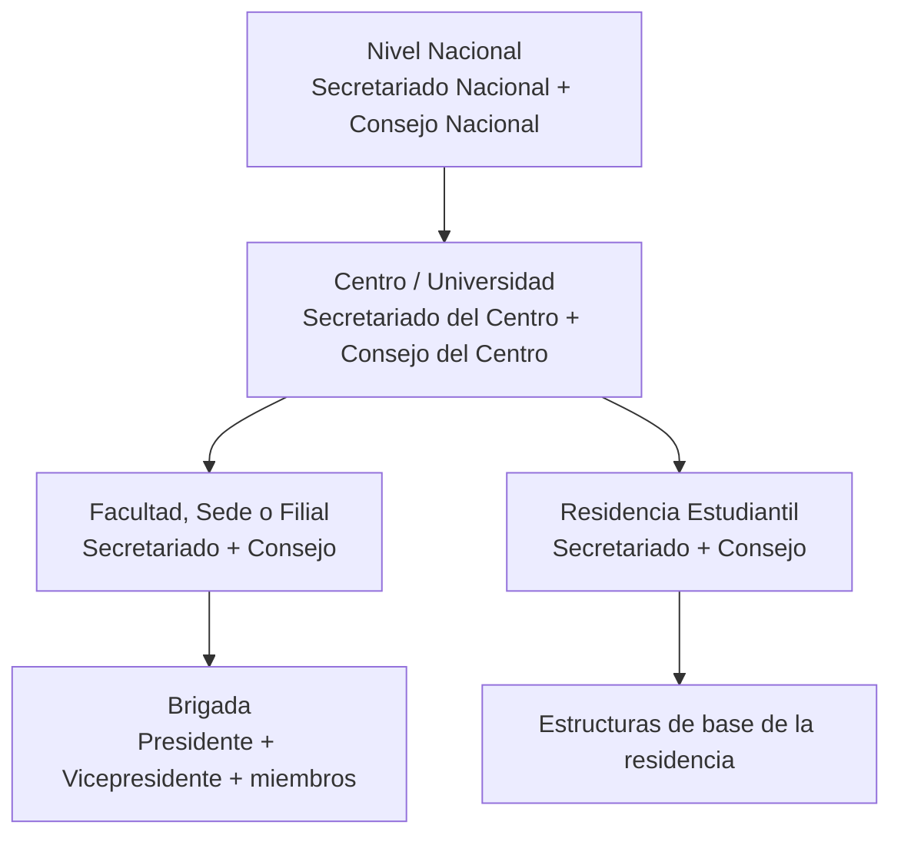
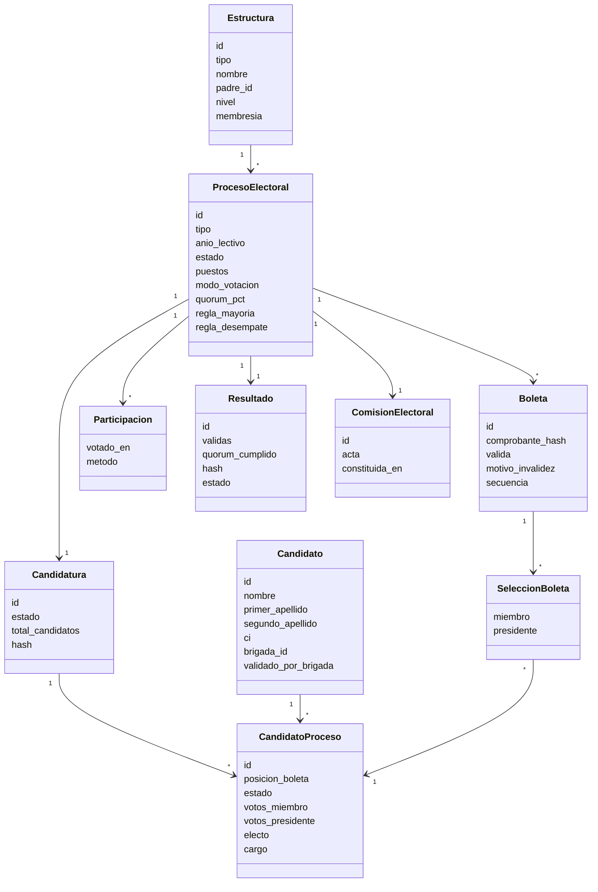
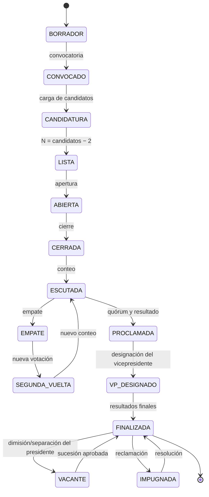

# 08 - Marco legal de la FEU y generalización del sistema

> **Fuente normativa:** `ABC-FEU-2019.pdf` (114 páginas), que contiene la Declaración Final del IX Congreso, los Estatutos y el Reglamento de la FEU. Este documento sustituye como referencia legal al extracto incompleto `Proyecto FEU/Información.txt`, que solo incluía los artículos 36–42 y 73–77.
>
> **Alcance vigente:** v1 implementa la elección del **Secretariado de la Facultad de Ingeniería Informática**. El modelo de datos y las reglas se diseñan para escalar a otras facultades, sedes, filiales, centros y al nivel nacional.
>
> **Convención:** las reglas se citan por artículo del Reglamento/Estatutos. Cuando una interpretación no es literal, se marca como **interpretación** o **decisión pendiente**.

> **Decisiones de alcance v1 (fijadas por el cliente):**
> 1. Se cargan **todos los candidatos** y de ahí se deriva el número de puestos: `N = candidatos − 2`. No se pide `N` por separado.
> 2. **No se exige** validación por brigada ni aprobación del Consejo como requisito del sistema. Se pueden registrar como referencia, pero no bloquean la apertura.
> 3. El **vicepresidente** no se elige en la boleta: se designa **después del cierre** y antes de los resultados finales. Sin plazo de 3 días.
> 4. El sistema contempla la **dimisión o separación del presidente** y la consecuente vacante.

---

## 1. Por qué cambia el alcance

La primera especificación (documentos hoy retirados) se construyó sobre tres fuentes mezcladas:

1. El código de la demo Java/Swing.
2. Un extracto incompleto del reglamento (`Información.txt`, Arts. 36–42 y 73–77).
3. Decisiones de implementación de la demo que se tomaron como si fueran reglas.

Eso produjo supuestos que **no resisten la lectura del reglamento completo**:

| Supuesto anterior | Lo que dice el reglamento | Corrección |
|---|---|---|
| La elección es de universidad, con 9 puestos y 11 candidatos. | Art. 36: la Facultad elige su Secretariado cada año. Art. 59: candidatos = puestos + 2. | v1: Facultad. Se cargan los candidatos y se deriva `N = candidatos − 2`; la demo fija **11 candidatos → 9 puestos**. |
| Se deben marcar **exactamente 9** miembros. | Art. 61: se podrá marcar **hasta** cuantos miembros deba tener la estructura. | Boleta válida con **1..N** marcas de miembro, no exactamente N. |
| El presidente se elige entre los 9 más votados. | Art. 63: son miembros los de mayor cantidad de votos; de los electos, presidente el de más votos para presidente. | Presidente entre los **N electos**, no entre un número fijo 9. |
| El desempate final es por orden alfabético o de lista. | Art. 40: empate para miembro → votos de presidente; empate para presidente → **nueva votación** entre los implicados. | Prohibido desempatar por orden alfabético. Se implementa balotaje. |
| El 80 % excepcional aplica a cualquier nivel. | Art. 38: el 80 % excepcional es **solo a nivel de universidad**, previa consulta al Secretariado Nacional. | Facultad: **>85 %**, sin excepción del 80 %. |
| La boleta de Facultad lleva columna «Facultad». | Art. 60: la boleta de Facultad lleva **Brigada**. Art. 74: la de universidad lleva Facultad. Art. 90: la nacional lleva Provincia. | Columnas configurables por nivel. |
| No hay espacios para otras propuestas. | Art. 59: la boleta tiene **dos espacios en blanco** para otras propuestas. | **Fuera de v1** (Q-L03): no se muestran ni capturan; trabajo futuro. |
| No se valida el candidato por su brigada. | Art. 39: para ser dirigente, el estudiante debe haber sido **validado por su brigada**. | **Fuera de v1 como requisito.** Se registra si existe, pero no bloquea. |
| No se aprueba la candidatura por el Consejo. | Art. 42: la candidatura se compone de propuestas **aprobadas en el Consejo**. Art. 56: 85 % de presencia y 50 %+1. | **Fuera de v1 como requisito.** La lista cargada es la candidatura. |
| Solo existe voto secreto. | Art. 37: voto secreto, excepto estructuras de **≤100 miembros**, que votan directo y público. | v1: **siempre secreto** (se asume >100). El modo público queda diferido. |
| No hay segunda vuelta, reclamaciones ni retención. | Arts. 40, 103–108 y 66. | Balotaje, reclamaciones y retención de 1 año. |
| No hay Comisión Electoral como entidad. | Arts. 41–48. | Comisión con composición, roles y actas. |
| El secretario/vicepresidente se elige en la boleta. | Art. 67: el Consejo aprueba al vicepresidente a propuesta del Secretariado electo. | El voto elige miembros y presidente; el VP se **designa después del cierre**. |
| El presidente electo permanece hasta el final del mandato. | Arts. 99–102: separación y promoción por vacante, con aprobación del Consejo. | Se modela la **dimisión/separación** y la vacante con sucesión. |

> **Dato clave:** los anexos del Reglamento usan **5** miembros para Facultad (Art. 62), **7** para Universidad (Art. 75) y **13** para Nacional (Art. 91). Ninguno usa 9. El par **9 puestos / 11 candidatos** es una **decisión del cliente para la demo**, no una constante legal: el sistema la obtiene de `N = candidatos − 2` y admite cualquier otro tamaño de lista.

### 1.1 El problema del extracto anterior

`Información.txt` contiene solo:

- Arts. 36–42 (periodicidad, voto, quórum, validación, empate, Comisión, candidatura).
- Arts. 73–77 (boleta y escrutinio **de universidad**).

Quedaron fuera, entre otros:

- Arts. 43–48: funciones y composición de la Comisión Electoral.
- Arts. 49–53: proceso de brigada y voto público.
- Arts. 54–58: candidatura de Facultad y caso de menos de 100 miembros.
- Arts. 59–66: boleta, votación, conteo y retención **de Facultad**.
- Arts. 67–68: primera reunión del Consejo y sucesiones.
- Arts. 69–79: nivel de centro/universidad.
- Arts. 80–98: nivel nacional y Congreso.
- Arts. 99–108: separación, vacantes y reclamaciones.

Además, el extracto corta el Art. 76 antes del umbral de **más del 50 % de los votos válidos** para el nivel de universidad. Esa omisión es la razón por la que la demo no implementó el umbral.

---

## 2. Estructura organizativa

| Nivel | Órgano de dirección | Composición | Fuente |
|---|---|---|---|
| Brigada | Presidente y Vicepresidente | Miembros de la brigada; 3–45 miembros, salvo excepción aprobada por el Consejo. | Arts. 3, 7 y 12. |
| Facultad / Sede / Filial | Secretariado | Presidente, Vicepresidente y demás miembros. | Arts. 10 y 13. |
| Facultad / Sede / Filial | Consejo | Secretariado + Presidentes de Brigadas (+ Presidente de Residencia si existe). | Arts. 10, 11 y 13. |
| Centro / Universidad | Secretariado | Presidente, Vicepresidente y dirigentes de secretarías de trabajo. | Art. 21. |
| Centro / Universidad | Consejo | Secretariado + Presidentes de Facultades/Sedes/Filiales + Presidente de Residencia. | Art. 21. |
| Nacional | Secretariado | Presidente, Vicepresidente y miembros permanentes/no permanentes. | Arts. 81–98. |
| Nacional | Consejo | Estructura aprobada por el Congreso. | Art. 81. |

**Implicación para el sistema:** la unidad de configuración no es «la elección» sino **`Estructura` + `ProcesoElectoral`**. Una estructura tiene nivel, padre, membresía y consejo. Un proceso tiene reglas propias según el nivel.

---

## 3. Proceso electoral por nivel

| Nivel | Órgano que se elige | Periodicidad | Electorado | Modo | Puestos | Candidatura | Mayoría | Quórum | Columnas |
|---|---|---|---|---|---|---|---|---|---|
| Brigada | Presidente y Vicepresidente | Anual, inicio de curso | Miembros de la brigada | Público, directo | 1 presidente + 1 vicepresidente | Propuestas de los miembros | Mayoría simple por cargo | No se especifica en el texto | No aplica boleta de secretariado |
| Facultad / Sede / Filial | Secretariado | Anual, inicio de curso | Membresía de la estructura | Secreto; público si ≤100 | N (muestra: 5) | N+2; v1 carga directa | Top N por miembro; presidente por votos de presidente | >85 % | Apellidos y Nombres, Brigada, Miembro, Presidente |
| Facultad <100 | Presidente (y candidatura) | Anual | Membresía | Público, directo | 1 presidente | Candidatura presentada por la Comisión | Presidente más votado | >85 % | No especificada |
| Centro / Universidad | Secretariado | Anual | Estudiantes del centro | Secreto; público si ≤100 | N (muestra: 7) | N+2, aprobada por el Consejo | Top N con **>50 % de votos válidos**; si no, nueva candidatura y nueva votación | >85 %; 80 % excepcional con Secretariado Nacional | Apellidos y Nombres, Facultad/Sede/Filial, Miembro, Presidente |
| Nacional | Secretariado | Cada 2 años | Consejo/Congreso según el caso | Secreto (Congreso); público en aprobación anual | 19 (13 permanentes + no permanentes) | 19 propuestas; boleta de 13 | 50 %+1 | No se especifica | Apellidos y Nombre, Provincia, Miembro, Presidente |

> La tabla resume el Reglamento; no todas las combinaciones están implementadas en v1. La columna «N» es un parámetro, no una constante.

> **Nota sobre el nivel nacional:** los Arts. 82 y 87–92 usan 19 candidatos/puestos y 13 marcas/permanentes de forma no del todo consistente. Se interpreta como 19 propuestas con 13 puestos permanentes y estructuras no permanentes aprobadas después; es un tema a validar si se escala a ese nivel.

### 3.1 Lectura para la Facultad de Ingeniería Informática

- **Nivel:** Facultad.
- **Órgano:** Secretariado de Facultad (presidente + vicepresidente + miembros).
- **Puestos:** derivados de la lista cargada: `N = candidatos − 2` (Art. 59). La muestra del Art. 62 usa 5 (7 candidatos), pero **la demo usa 11 candidatos → 9 puestos** por decisión del cliente. El número no se configura: se deriva.
- **Candidatos:** todos los que se carguen; el sistema calcula `N` y la boleta muestra la lista completa. La demo carga **11**.
- **Electorado:** toda la membresía de la Facultad (no solo los «usuarios registrados» de la demo).
- **Modo:** **secreto**; v1 asume que la Facultad siempre tiene **>100** miembros. El modo público y el Art. 58 quedan diferidos a una fase final.
- **Quórum:** más del 85 % de la membresía; sin excepción del 80 %.
- **Boleta:** 4 columnas: Apellidos y Nombres, Brigada, Votos para Miembro, Votos para Presidente.
- **Marcas:** hasta `N` miembros; exactamente 1 presidente, que debe ser uno de los marcados como miembro.
- **Sin voto en blanco:** 0 marcas es inválida. El elector puede **anular** la boleta en dos pasos (ver §4.4).
- **Escrutinio:** top `N` por votos de miembro; presidente entre los `N` electos por votos de presidente.
- **Empate:** miembro → votos de presidente; presidente → nueva votación entre los implicados.
- **Post-elección:** cerrada la votación y escrutado el resultado, se **designa el vicepresidente**; luego se publican los resultados finales. Sin plazo de 3 días.
- **Vacante:** si el presidente dimite o es separado, se registra el hecho y se aplica la sucesión (Arts. 99–102).

---

## 4. Análisis de los artículos relevantes

### 4.1 Arts. 36–42 · Elementos generales

| Art. | Contenido | Implicación | v1 |
|---|---|---|---|
| 36 | Periodicidad: brigada, facultad, centro cada año; nacional cada 2 años. | El proceso tiene año, convocatoria y fecha; no es un estado global. | Sí |
| 37 | Voto directo y secreto; público si ≤100 miembros; convocatoria a toda la membresía. | Modo de votación y padrón completo. | Sí |
| 38 | Validez con >85 %; 80 % excepcional solo universidad, previa consulta nacional. | Quórum por estructura; excepción solo nivel universidad. | Sí |
| 39 | Dirigente validado por su brigada. | Se registra como referencia; **no bloquea** en v1. | No |
| 40 | Empate para miembro → votos de presidente; empate para presidente → nueva votación. | Balotaje obligatorio; prohibido desempatar por orden. | Sí |
| 41 | El Consejo conforma la Comisión Electoral al final del curso. | Comisión como entidad y acta de constitución. | Sí |
| 42 | Candidatura compuesta por propuestas aprobadas en el Consejo. | Se registra como referencia; **no bloquea** en v1. | No |

### 4.2 Arts. 43–48 · Comisión Electoral

| Art. | Contenido | Implicación |
|---|---|---|
| 43 | Funciones: cronograma, seminarios, participación, recepción/valoración de propuestas, presentar candidatura, divulgar, constituir Comisión de Escrutinio, transparencia, rendir cuenta al Consejo. | La Comisión no es solo un rol de usuario: tiene tareas, actas y responsabilidades. |
| 44 | Facultada para decisiones imprescindibles, con consulta a la Comisión superior. | Registro de decisiones y justificación. |
| 45 | Se activa cuando se requiera. | Estados de la Comisión. |
| 46 | Composición a nivel de centro: Presidente, Vicepresidente y presidentes de comisiones inferiores. | Modelo de composición por nivel. |
| 47 | Facultad/Sede/Filial y Residencia: Presidente, Vicepresidente y representantes de brigadas/estructuras de base. | Comisión de Facultad con representantes de brigadas. |
| 48 | Subordinación a la Comisión superior y reporte al Consejo. | Jerarquía y rendición de cuentas. |

### 4.3 Arts. 49–58 · Brigadas, candidatura y caso de menos de 100

> **Alcance v1:** los Arts. 54–57 describen la formación y aprobación de la candidatura. El sistema **no la exige**: la lista de candidatos se carga directamente. Se conserva el análisis como referencia para una versión que quiera formalizar el trámite.

| Art. | Contenido | Implicación |
|---|---|---|
| 49 | Proceso de brigada: representante a la Comisión, dirección de brigada, propuestas para Facultad/Universidad. | Tres momentos; el sistema debe modelar propuestas y representantes. |
| 50 | Brigadas de primer año: coordinador hasta el ingreso oficial. | Estado especial de membresía. |
| 51 | Proceso de primer año dirigido por la Comisión de Facultad, tras explicación de Estatutos y firma de ingreso. | Evidencia de ingreso y rol de la Comisión. |
| 52 | Residencia: proceso directo. | Variante de estructura. |
| 53 | Brigada: voto directo y público, una sola vez; primero presidente, luego vicepresidente; gana el más votado. | Proceso distinto al de secretariado; no usar la boleta de Facultad. |
| 54 | La Comisión presenta propuestas al Consejo y luego a la estructura. | Flujo de candidatura en dos pasos. |
| 55 | Reunión del Consejo con 85 % de presencia y dirección de la Comisión. | Quórum de aprobación. |
| 56 | Candidatura con 2 propuestas más que la cifra a elegir; aprobación por 50 %+1 de los presentes. | `N+2` y mayoría de aprobación. |
| 57 | Si el Consejo rechaza, la Comisión valora nuevas propuestas. | Estado de rechazo/reelaboración. |
| 58 | Facultades con menos de 100 miembros: la Comisión presenta la candidatura a la membresía, que puede votar por su presidente una sola vez, público. | Modo especial; solo presidente. |

### 4.4 Arts. 59–68 · Boleta, votación, conteo y primera reunión

| Art. | Contenido | Implicación |
|---|---|---|
| 59 | Orden alfabético por **primer apellido**; `N+2` candidatos; **2 espacios en blanco** para otras propuestas. | Orden por primer apellido; modelar propuestas. |
| 60 | 4 columnas de Facultad: Apellidos y Nombres, **Brigada**, Miembro, Presidente. | Columnas por nivel. |
| 61 | Hasta `N` marcas de miembro; **un solo** presidente, que debe ser uno de los marcados como miembro. | Validación `1..N` + 1 presidente ∈ miembros. |
| 62 | Instrucciones breves; muestra de Facultad con 5 miembros. | 5 es una muestra del Reglamento; la demo usa 9 derivados de 11 candidatos. |
| 63 | Miembros = mayor cantidad de votos para miembro; presidente = de los electos, el de más votos para presidente. | Top `N`; presidente entre electos. Sin umbral en Facultad. |
| 64 | Residencia: proceso semejante al de Facultad según estructura y membresía. | Variante. |
| 65 | Conteo por la Comisión, en lugar que permita observar. | Observadores y transparencia. |
| 66 | Boletas conservadas mínimo 1 año, selladas, con acta de resultados firmada por el presidente de la Comisión. | Retención y acta. |
| 67 | Primera reunión del Consejo antes de 3 días hábiles; la Comisión presenta resultados; el Consejo aprueba al vicepresidente a propuesta del Secretariado electo; el presidente designa responsabilidades. | El VP se designa **después del cierre**. En v1 se aplica el fondo, no el plazo de 3 días. |
| 68 | Sucesión si un presidente/vicepresidente de brigada es electo al Secretariado. | Futuro; no v1. |

> **Decisión de v1 sobre la boleta inválida.** El Reglamento exige un mínimo de marcas y un solo presidente, pero no regula el voto nulo electrónico. v1 aplica:
> 1. **No existe voto en blanco.** 0 marcas es inválida y no se puede emitir como válida.
> 2. La UI valida y muestra los errores **inline** en un primer intento; no emite nada.
> 3. Si el elector insiste tras el aviso, la boleta se registra como **`ANULADA_POR_ELECTOR`** con sus selecciones crudas y los motivos.
> 4. La anulada **cuenta como votante** (suma a la participación y al quórum), **no suma votos** a ningún candidato y **consume el voto**.
> 5. Abstenerse es **no votar**: quien no emite boleta no suma a la participación.

### 4.5 Arts. 69–79 · Centro y Universidad

| Art. | Contenido | Implicación |
|---|---|---|
| 69 | Candidatura del centro aprobada por el Consejo con 50 %+1. | Nivel universidad. |
| 70 | Reunión con más del 85 % de los miembros del Consejo. | Quórum. |
| 71 | Boleta con `N+2` candidatos. | Generalización. |
| 72 | Presidentes de Facultad/Sede/Filial pueden ser parte de la candidatura; si son electos, los sustituye el segundo más votado para presidente. | Sucesión. |
| 73 | Orden por primer apellido; `N+2`; 2 espacios en blanco. | Igual que Facultad. |
| 74 | 4 columnas: Nombre y apellidos, **Facultad/Sede/Filial**, Miembro, Presidente. | Columna distinta. |
| 75 | Instrucciones; muestra de universidad con 7 miembros. | `N=7` de referencia. |
| 76 | Miembros = mayor cantidad de votos, **siempre que superen el 50 % de los votos válidos**; si no, nueva candidatura y nueva votación. | Regla exclusiva de universidad. |
| 77 | Presidente = miembro con más votos para presidente. | Igual. |
| 78 | Conteo por la Comisión, con observadores. | Igual. |
| 79 | Primera reunión del Consejo del Centro antes de 3 días hábiles; aprobación del vicepresidente. | Post-elección. |

### 4.6 Arts. 80–98 · Nivel nacional

| Art. | Contenido | Implicación |
|---|---|---|
| 80–86 | Delegados al Congreso; candidatura nacional de 19 para elegir 19; aprobación 50 %+1; Comisión de Escrutinio. | Futuro; modelo de delegados. |
| 87–94 | Boleta nacional: 13 miembros, 4 columnas con Provincia, 2 espacios; miembros con 50 %+1; presidente el más votado; conteo por Comisión de Escrutinio. | Futuro. |
| 95–98 | Primera reunión del Secretariado y del Consejo Nacional; publicación de resultados. | Futuro. |

### 4.7 Arts. 99–108 · Separación, vacantes y reclamaciones

| Art. | Contenido | Implicación |
|---|---|---|
| 99 | Separar/liberar a un miembro: Consejo con >85 % de presencia y 50 %+1; si es voluntario y no sanción, no se lleva a aprobación; entrega en ≤1 mes. | Futuro; módulo de vacantes. |
| 100 | Promover a miembro por vacante: Consejo con >85 % y 50 %+1. | Futuro. |
| 101 | Separar a un presidente: Consejo que dirige y al que pertenece; si no hay consenso, Consejo superior; >85 % y 50 %+1. | Futuro. |
| 102 | Promover a presidente por vacante: Secretariado superior y Consejo; >85 % y 50 %+1. | Futuro. |
| 103 | Reclamaciones hasta 5 días hábiles después de publicados los resultados. | v1: registro y plazo. |
| 104 | Si la reclamación es por la Comisión, la conforma la Comisión superior; informar al Secretariado Nacional. | Flujo de escalamiento. |
| 105 | Comisión presidida por el presidente de la Comisión superior; máximo 5 miembros; a nivel universidad, la preside el Organizador del Secretariado Nacional. | Composición. |
| 106 | 15 días hábiles para el proceso. | Plazo. |
| 107 | Conclusiones se dan a conocer en el Consejo de la estructura de origen. | Acta y comunicación. |
| 108 | Principios de justicia, honestidad, responsabilidad, imparcialidad y racionalidad. | Criterios de resolución. |

### 4.8 Módulo «Reglamento» del sistema

El sistema incluye una sección **Reglamento** que transcribe literalmente los artículos aplicables, con su fuente. Para v1 (Facultad) se transcriben, al menos:

| Artículo | Fuente | Motivo de inclusión |
|---|---|---|
| 36–42 | ABC-FEU-2019.pdf, Reglamento de la FEU, Arts. 36–42 | Periodicidad, voto, quórum, Comisión, candidatura |
| 43–48 | Ídem | Comisión Electoral |
| 49–58 | Ídem | Brigadas, candidatura, caso de menos de 100 |
| 59–68 | Ídem | Boleta, votación, conteo, primera reunión, retención |
| 99–108 | Ídem | Separación, vacantes y reclamaciones |
| 10–13 | Ídem | Composición de Consejos y Secretariados |

**Reglas del módulo**

- El texto se transcribe **literalmente**, sin parafrasear; se conserva la numeración del original.
- Cada artículo registra: documento, número de artículo, **página** y hash del PDF fuente.
- El documento fuente se versiona (`ABC-FEU-2019.pdf` con su hash) para detectar cambios.
- La UI permite buscar por número de artículo y por texto.
- Las reglas del proceso (RGF) enlazan al artículo que las origina.

---

## 5. Reglas generalizadas (RGF)

Estas reglas sustituyen, para el alcance v1 y la escalabilidad, a las reglas de la demo que dependían de constantes. Cada una indica el artículo y el parámetro que la hace configurable.

| ID | Regla | Artículo | Parámetro | v1 |
|---|---|---|---|---|
| RGF-01 | Cada estructura celebra su proceso con la periodicidad que le corresponde; la Facultad, cada curso escolar. | 36 | `periodicidad`, `anio_lectivo` | Sí |
| RGF-02 | La convocatoria es extensiva a toda la membresía de la estructura. | 37 | `padron` | Sí |
| RGF-03 | El voto es directo y secreto; la ley lo hace público si la membresía es ≤100. **v1 asume >100 y usa siempre secreto**; el modo público queda diferido. | 37 | `modo_votacion` | Secreto |
| RGF-04 | La elección es válida con más del 85 % de sufragio; el 80 % excepcional solo aplica a nivel de universidad, con consulta al Secretariado Nacional. | 38 | `quorum_pct`, `quorum_excepcional_pct`, `quorum_excepcional_ambito` | Sí |
| RGF-05 | La validación por brigada se registra como referencia; **no es requisito** para cargar o abrir. | 39 | `validacion_brigada` | No |
| RGF-06 | La aprobación del Consejo se registra como referencia; **no es requisito** en v1. | 42 | `aprobacion_consejo` | No |
| RGF-07 | Si se registra la aprobación del Consejo, se anotan presencia y votos; no bloquea. | 55–56 | `quorum_consejo_pct`, `mayoria_consejo` | Referencia |
| RGF-08 | Se cargan todos los candidatos y se derivan los puestos: `N = candidatos − 2`; la boleta muestra la lista completa. Los 2 espacios de propuesta del Art. 59 **no se implementan en v1**. | 59 | `puestos = candidatos − 2`, `espacios_propuesta=0` | Parcial |
| RGF-09 | El orden de la boleta es alfabético por primer apellido, con desempate determinista. | 59 | `orden_boleta` | Sí |
| RGF-10 | Las columnas de la boleta dependen del nivel: Brigada (Facultad), Facultad (Universidad), Provincia (Nacional). | 60, 74, 90 | `columnas_boleta` | Sí |
| RGF-11 | Se puede marcar hasta `N` miembros y exactamente 1 presidente, que debe estar entre los marcados como miembro. | 61 | `max_marcas_miembro`, `marcas_presidente=1` | Sí |
| RGF-12 | Son electos los `N` candidatos con más votos de miembro. | 63 | `puestos` | Sí |
| RGF-13 | El presidente es, entre los electos, el que más votos de presidente obtiene. | 63 | `presidente_entre_electos=true` | Sí |
| RGF-14 | Empate para miembro: se comparan los votos de presidente. Empate para presidente: nueva votación entre los implicados. | 40 | `desempate` | Sí |
| RGF-15 | En Facultad no hay umbral de 50 %; en Universidad se exige >50 % de votos válidos y, si no se alcanza, nueva candidatura y votación; en Nacional, 50 %+1. | 63, 76, 92 | `regla_mayoria` | Facultad |
| RGF-16 | El conteo lo realiza la Comisión, en un lugar observable. | 65 | `observadores` | Sí |
| RGF-17 | Las boletas se conservan al menos 1 año, selladas, con acta firmada por el presidente de la Comisión. | 66 | `retencion_boletas_dias=365` | Sí |
| RGF-18 | El vicepresidente se designa **después del cierre**, antes de los resultados finales, y debe ser **uno de los `N` electos**. Se recomienda el electo con más votos de miembro que no sea presidente, pero la Comisión puede elegir a otro electo. No se exige el plazo de 3 días. | 67 | `designacion_vp = post_cierre`, `vp_entre_electos = true` | Sí |
| RGF-19 | En Facultades con menos de 100 miembros, la candidatura se presenta a la membresía y se vota públicamente por el presidente una sola vez. | 58 | `modo_facultad_pequena` | Diferido |
| RGF-20 | Las reclamaciones se presentan hasta 5 días hábiles después de la publicación; la Comisión superior tiene 15 días hábiles. | 103–106 | `plazo_reclamacion=5`, `plazo_resolucion=15` | Registro |
| RGF-21 | La separación o vacante se aprueba con >85 % de presencia y 50 %+1 del Consejo. | 99–102 | `quorum_vacante`, `mayoria_vacante` | Sí (registro) |
| RGF-22 | La Comisión Electoral se conforma por nivel y tiene presidente, vicepresidente y representantes; sus funciones y decisiones se registran. | 41–48 | `comision` | Sí |
| RGF-23 | El Consejo de Facultad se compone del Secretariado y los presidentes de brigada. | 10–11 | `consejo` | Sí |
| RGF-24 | La brigada se conforma con 3–45 miembros, salvo excepción aprobada. | 3 | `membresia_brigada` | Sí |
| RGF-25 | Cada miembro vota una sola vez; no hay voto múltiple ni delegación. | 37, 53 | `un_voto` | Sí |
| RGF-26 | El voto es secreto y no se vincula la boleta con el votante. | 37 | `secreto` | Sí |
| RGF-27 | Los resultados se publican oficialmente después de la proclamación y se conservan con el acta. | 66, 98 | `publicacion` | Sí |
| RGF-28 | El proceso puede repetirse por empate o por nueva candidatura, sin reabrir la votación original. | 40, 76 | `segunda_vuelta` | Sí |
| RGF-29 | El sistema debe soportar niveles, estructuras y reglas distintas sin cambiar el código del dominio. | 36–38, 59–63 | `configuracion` | Sí |
| RGF-30 | El acta y los resultados son inmutables y auditables; cualquier corrección genera una nueva versión. | 65–66 | `auditoria` | Sí |
| RGF-31 | La dimisión, separación, incapacidad o fallecimiento del presidente genera una vacante. Por defecto **asume el vicepresidente**; la Comisión puede elegir a otro de los electos. El sistema registra el hecho, el acta y la sucesión. | 99–102 | `evento_vacante`, `sucesion` | Sí (registro) |
| RGF-32 | La composición final es presidente + vicepresidente + (`N`−2) miembros; si el VP no se designa, el resultado queda `PROCLAMADO PARCIAL` hasta completarlo. | 13, 63, 67 | `composicion` | Sí |
| RGF-33 | El sistema expone un módulo «Reglamento» con el **texto literal** de los artículos aplicables, fuente (documento, artículo, página) y hash del PDF. | 36–108 | `reglamento` | Sí |
| RGF-34 | La importación de datos (CSV/XLSX) valida contra una plantilla; las brigadas deben existir antes; cada candidato se selecciona de los datos ya importados o creados. | 59 | `importacion`, `plantilla` | Sí |

---

## 6. Decisiones de alcance de v1

| Tema | Decisión v1 | Fundamento |
|---|---|---|
| Candidatos | Se cargan todos; los puestos se derivan con `N = candidatos − 2`. | Art. 59 |
| Validación por brigada | Se registra si existe; **no bloquea**. | Art. 39 (no exigido en v1) |
| Aprobación del Consejo | Se registra si existe; **no bloquea**. | Art. 42 (no exigido en v1) |
| Marcas de miembro | `1..N`; `0` es inválida | Art. 61 |
| Boleta inválida | Aviso inline; si insiste, `ANULADA_POR_ELECTOR` | Decisión v1 |
| Presidente | Entre los `N` electos | Art. 63 |
| Modo de votación | **Secreto**; se asume padrón >100 | Arts. 37, 58 (diferido) |
| Vicepresidente | Se designa después del cierre, **entre los `N` electos**; recomendado el siguiente más votado | Art. 67 |
| Vacante presidencial | Por defecto **asume el vicepresidente**; se puede elegir otro electo. Se registra y versiona la composición | Arts. 99–102 |
| Espacios de propuesta | **No se implementan en v1** | Art. 59 (diferido) |
| Quórum | `>85 %` | Art. 38 |
| Empate | Votos de presidente; balotaje | Art. 40 |

**No se implementa en v1:** el trámite de constitución de la candidatura (Arts. 54–57) ni la validación/aprobación como condiciones bloqueantes. El sistema admite esos datos como referencia y los muestra en el acta si están cargados.

---

## 7. Modelo de dominio generalizado

### 7.1 Entidades

| Entidad | Propósito | Campos clave |
|---|---|---|
| `Estructura` | Brigada, Facultad, Sede, Filial, Residencia, Centro o Nacional. | `id`, `tipo`, `nombre`, `padre_id`, `nivel`, `membresia`, `activa`. |
| `Membresia` | Persona habilitada para votar en una estructura. | `id`, `estructura_id`, `estudiante_id`, `nombre`, `brigada_id`, `habilitada`, `usuario_id`. |
| `ProcesoElectoral` | Proceso concreto de una estructura y un año. | `id`, `estructura_id`, `tipo`, `anio_lectivo`, `estado`, `candidatos_count`, `puestos` (derivado), `espacios_propuesta`, `modo_votacion`, `quorum_pct`, `quorum_excepcional_pct`, `regla_mayoria`, `regla_desempate`, `columnas`, `abre_en`, `cierra_en`, `snapshot_hash`. |
| `Candidatura` | Lista cargada de candidatos (antes «aprobada»). | `id`, `proceso_id`, `estado`, `total_candidatos`, `hash`. |
| `Candidato` | Dato maestro de la persona. | `id`, `nombre`, `primer_apellido`, `segundo_apellido`, `ci`, `facultad_id`, `brigada_id`, `anno`, `genero`, `validado_por_brigada` (opcional), `evidencia_validacion` (opcional), `biografia_md` (opcional), `biografia_hash`, `biografia_actualizada_en`. |
| `CandidatoProceso` | Instantánea del candidato en el proceso. | `id`, `proceso_id`, `candidato_id`, `posicion_boleta`, `estado`, `elegible`, `votos_miembro`, `votos_presidente`, `electo`, `cargo`. |
| `Boleta` | Voto emitido, sin vínculo al votante. | `id`, `proceso_id`, `comprobante_hash`, `estado` (`VALIDA`/`ANULADA_POR_ELECTOR`), `motivos`, `emitida_en`, `secuencia`, `hash_integridad`, `modo`. |
| `SeleccionBoleta` | Marca de miembro/presidente. | `boleta_id`, `candidato_proceso_id`, `miembro`, `presidente`. |
| `PropuestaBoleta` | Contenido de los 2 espacios en blanco. | `boleta_id`, `slot`, `nombre_propuesto`, `brigada_propuesta`, `estado`. |
| `Participacion` | Prueba de que un miembro votó. | `proceso_id`, `membresia_id`, `votado_en`, `metodo`; único. |
| `Resultado` | Resultado inmutable del escrutinio. | `id`, `proceso_id`, `validas`, `anuladas`, `participacion`, `quorum_pct`, `quorum_cumplido`, `hash`, `estado`, `proclamado_en`, `composicion`. |
| `ResultadoCandidato` | Totales por candidato. | `resultado_id`, `candidato_proceso_id`, `votos_miembro`, `votos_presidente`, `electo`, `orden`, `cargo`. |
| `DesignacionVicepresidente` | Designación posterior al cierre. | `id`, `proceso_id`, `electo_id`, `recomendado_id`, `designado_por`, `acta`, `designado_en`, `estado`. |
| `EventoVacante` | Dimisión, separación, incapacidad o fallecimiento. | `id`, `proceso_id`, `cargo`, `tipo`, `motivo`, `acta`, `ocurrido_en`, `sucesor_id`, `sucesor_recomendado_id`, `estado`. |
| `ComisionElectoral` | Comisión del proceso. | `id`, `proceso_id`, `presidente_id`, `vicepresidente_id`, `miembros`, `constituida_en`, `acta`. |
| `Acta` | Documento de resultados/proclamación. | `id`, `proceso_id`, `tipo`, `contenido`, `hash`, `firmada_en`, `firmantes`. |
| `Reclamacion` | Impugnación o consulta. | `id`, `proceso_id`, `presentada_por`, `motivo`, `estado`, `plazo`, `resolucion`. |
| `Importacion` | Carga de padrón o de candidatos por CSV/XLSX. | `id`, `proceso_id`, `tipo`, `archivo_hash`, `plantilla_version`, `estado`, `filas_ok`, `filas_error`, `creado_en`. |
| `Plantilla` | Plantilla oficial de importación. | `id`, `tipo`, `version`, `encabezados`, `ejemplo`, `hash`, `vigente_desde`. |
| `ReglamentoArticulo` | Texto literal de un artículo aplicable. | `id`, `documento`, `articulo`, `pagina`, `texto_literal`, `hash_fuente`, `vigente`. |
| `EventoAuditoria` | Traza append-only. | `id`, `proceso_id`, `actor_id`, `accion`, `entidad`, `payload_hash`, `ocurrido_en`, `secuencia`. |

### 7.2 Diagrama conceptual

### 7.3 Invariantes generalizadas

| ID | Invariante |
|---|---|
| INV-01 | Cada boleta válida tiene entre 1 y `N` marcas de miembro; `0` es inválida y solo puede emitirse como anulada. |
| INV-02 | Cada boleta válida tiene exactamente 1 marca de presidente. |
| INV-03 | La marca de presidente corresponde a un candidato marcado como miembro. |
| INV-04 | `votos_presidente_totales = boletas_válidas`. |
| INV-05 | `votos_miembro_totales = Σ marcas de miembro` y `≤ N × boletas_válidas`. |
| INV-06 | Un miembro tiene como máximo una participación por proceso. |
| INV-07 | `boletas` no contiene `membresia_id` ni `votante_id`. |
| INV-08 | El resultado es idempotente: repetir el escrutinio produce el mismo hash y totales. |
| INV-09 | El orden de la boleta no cambia después de la apertura. |
| INV-10 | La asignación de votos es por `candidato_proceso_id`, no por posición. |
| INV-11 | No se proclama sin quórum, sin boletas válidas o con empate sin resolver. |
| INV-12 | El acta y el resultado son inmutables; una corrección genera nueva versión. |
| INV-13 | `N = candidatos − 2` y `N ≥ 3`; la boleta muestra exactamente `N+2` filas. |
| INV-14 | El vicepresidente se designa después del cierre y pertenece a los `N` electos (salvo excepción justificada). |
| INV-15 | La composición final es 1 presidente + 1 vicepresidente + (`N`−2) miembros; toda vacante genera una nueva versión de composición. |
| INV-16 | `participación = válidas + anuladas`; las anuladas no suman votos. |
| INV-17 | La biografía `.md` se sanitiza al guardar y al renderizar; no ejecuta HTML ni scripts. |
| INV-18 | El módulo Reglamento muestra el texto literal del artículo con su fuente y página. |

### 7.4 Máquina de estados

> `SEGUNDA_VUELTA` se modela como **proceso hijo** para conservar la trazabilidad. `VACANTE` no reabre la votación: registra un hecho posterior y una nueva versión de la composición.

---

## 8. Configuración propuesta para v1

| Parámetro | Valor propuesto | Fundamento / nota |
|---|---|---|
| Estructura | Facultad de Ingeniería Informática | Alcance del cliente. |
| Nivel | `FACULTAD` | Art. 36. |
| Órgano | Secretariado de Facultad | Arts. 10 y 13. |
| Candidatos | Todos los que se carguen; la demo usa **11** | Art. 59. |
| Puestos (`N`) | **Derivado**: `candidatos − 2`; 11 → **9** | Art. 59. El Anexo 2 usa 5 como muestra, no como regla. |
| Espacios de propuesta | **Fuera de v1** (Q-L03) | Art. 59; fase final. |
| Electorado | Membresía de la Facultad; la demo usa **300** | Art. 37. |
| Modo | **Secreto**; se asume >100 | Arts. 37 y 58; el modo público queda diferido. |
| Quórum | **>85 %** | Art. 38. |
| Excepción 80 % | **No aplica a Facultad** | Art. 38. |
| Marcas de miembro | **1..N**; `0` es inválida | Art. 61. No hay voto en blanco. |
| Boleta inválida | Aviso inline; si insiste, **anulada por el elector** | Decisión v1; cuenta participación, no suma. |
| Marcas de presidente | **1**, entre los miembros marcados | Art. 61. |
| Electos | Top `N` por votos de miembro | Art. 63. |
| Presidente | Entre los `N` electos, el de más votos de presidente | Art. 63. |
| Umbral de mayoría | **Ninguno** en Facultad | Art. 63; el >50 % es de universidad (Art. 76). |
| Empate | Miembro → votos de presidente; presidente → nueva votación | Art. 40. |
| Columnas | Apellidos y Nombres, Brigada, Miembro, Presidente | Art. 60. |
| Validación de candidato | Opcional; solo referencia | Art. 39. No bloquea en v1. |
| Aprobación de candidatura | Opcional; solo referencia | Art. 42. No bloquea en v1. |
| Comisión | Presidente, vicepresidente y representantes de brigadas | Art. 47. |
| Retención | ≥1 año, sellada, con acta | Art. 66. |
| Vicepresidente | Se designa después del cierre, entre los electos; sin plazo | Art. 67. |
| Vacante presidencial | Asume el VP por defecto; se puede elegir otro electo | Arts. 99–102. |
| Reclamaciones | 5 días hábiles; 15 días hábiles de resolución | Arts. 103–106. |

> **Regla de oro:** `N` no se configura por separado. Se deriva de la lista de candidatos: `N = candidatos − 2`. La demo carga **11 candidatos → 9 puestos**. Se exige un mínimo de 5 candidatos (`N ≥ 3`) para que la composición tenga presidente, vicepresidente y al menos un miembro.

---

## 9. Escalabilidad

### 9.1 Qué cambia por nivel y qué no

| Dimensión | Brigada | Facultad | Universidad | Nacional |
|---|---|---|---|---|
| Órgano | Presidente/VP | Secretariado | Secretariado | Secretariado |
| Puestos | 1+1 | `N = candidatos − 2` | `N` (7 ref.) | 13 |
| Candidatura | Propuestas de miembros | Lista cargada | Lista cargada | 19/13 |
| Vicepresidente | Se elige en brigada | Se designa post-cierre | Se designa post-cierre | Se designa post-cierre |
| Modo | Público | Secreto/público | Secreto/público | Secreto |
| Quórum | No especificado | >85 % | >85 %; 80 % excepcional | No especificado |
| Mayoría | Simple | Top `N` | Top `N` >50 % válidos | 50 %+1 |
| Columnas | No aplica | Brigada | Facultad | Provincia |
| Empate | Simple | Presidente/balotaje | Presidente/balotaje | Presidente/balotaje |

**No cambia:** identidad, secreto, participación única, auditoría, acta, retención, boleta sin vínculo, snapshot inmutable, conteo idempotente.

### 9.2 Estrategia de escalado

- **Configuración, no código:** columnas, modo, quórum y reglas de desempate son datos del proceso; `N` se deriva de la lista.
- **UI por nivel:** una misma pantalla de boleta renderiza columnas según configuración; no hay pantallas duplicadas.
- **Feature flags:** v1 habilita solo `FACULTAD`; las demás quedan detrás de flags hasta su validación.
- **Procesos hijos:** balotaje y nuevas candidaturas se modelan como procesos hijos, no como mutaciones del original.
- **Un solo despliegue:** monolito modular; no se justifican microservicios.

> **Alcance de v1:** sede, filial, residencia, centro y nacional **no se implementan**: no hay código, pantallas ni endpoints para esos niveles. El modelo de datos los admite y esta sección documenta el trabajo futuro. Convertirlos en producto exige definir padrón, quórum, columnas y mayoría por nivel, y validar los Arts. 69–98 con la Comisión.
>
> Además, la boleta no incluye los dos espacios de propuesta del Art. 59 (Q-L03) y no se implementa el voto público para ≤100 ni el Art. 58 (Q-L04/Q-L05). Ambos quedan como fases finales; el modelo los admite sin código ni UI.

---

## 10. Decisiones y preguntas abiertas

### 10.1 Resueltas

| ID | Pregunta | Decisión |
|---|---|---|
| Q-L01 | ¿Cuántos puestos tiene el Secretariado? | **Resuelta:** la demo usa **9**, derivados de **11 candidatos** (`N = candidatos − 2`). El sistema no fija el número. |
| Q-L02 | ¿Una boleta sin marcas es voto en blanco o inválida? | **Resuelta:** no hay voto en blanco; `0` marcas es inválida. El elector puede **anularla en dos pasos**; la anulada cuenta participación, no suma y consume el voto. Abstenerse = no votar. |
| Q-L04 | ¿La membresía de la Facultad es >100? | **Diferida a fase final:** v1 asume siempre **>100** y voto secreto. El modo público y el Art. 58 no se implementan. |
| Q-L06 | ¿El vicepresidente se elige o se aprueba? | **Resuelta:** se designa después del cierre, antes de los resultados finales; sin plazo de 3 días. |
| Q-L10 | ¿Cómo se aporta la evidencia de brigada/Consejo? | **Resuelta:** no es requisito; se registra como referencia opcional. |
| Q-L13 | ¿El vicepresidente debe ser uno de los electos? | **Resuelta:** sí, siempre entre los `N` electos. Se recomienda el siguiente más votado, pero la Comisión puede elegir a otro electo. |
| Q-L14 | ¿Quién sucede al presidente si dimite? | **Resuelta:** por defecto asume el vicepresidente; la Comisión puede elegir a otro electo. Al ascender el VP, se recomienda el siguiente más votado para completar la composición, con opción de elegir otro electo. |

### 10.2 Diferidas a una fase final

| ID | Pregunta | Decisión v1 |
|---|---|---|
| Q-L03 | ¿Qué se hace con los 2 espacios de propuesta? | No se implementan: la boleta no los muestra ni los captura. |
| Q-L04 | ¿La membresía es >100? | Se asume siempre >100; voto secreto. |
| Q-L05 | Si ≤100, ¿solo se elige presidente? | Depende de Q-L04; no aplica en v1. |

### 10.3 Otras decisiones operativas

| ID | Pregunta | Propuesta por defecto |
|---|---|---|
| Q-L07 | ¿Se implementan reclamaciones en v1? | Registro y plazos en v1; resolución completa en v1.1. |
| Q-L08 | ¿Retención de 1 año o más? | 1 año mínimo; 5–7 años para actas. |
| Q-L09 | ¿Quiénes pueden observar el conteo? | Observadores acreditados por la Comisión. |
| Q-L11 | ¿Quién vota en la segunda vuelta? | Toda la membresía, entre los empatados. |
| Q-L12 | ¿Se publican resultados antes de proclamar? | No; solo después de proclamar. |

---

## 11. Resumen

- El reglamento completo cambia el alcance: **v1 es la Facultad de Ingeniería Informática**, no la universidad.
- Se cargan **todos los candidatos** y se deriva `N = candidatos − 2`; la demo usa **11 candidatos → 9 puestos**. `N` no es una constante.
- La boleta de Facultad es **hasta N miembros + 1 presidente**, no exactamente N.
- **No hay voto en blanco:** 0 marcas es inválida. El elector puede confirmar una **anulada** en dos pasos; cuenta participación y quórum, no suma votos y consume el voto. Quien no emite boleta no suma a la participación.
- El presidente sale de los **N electos**; el empate se resuelve por **votos de presidente** y, si persiste, **nueva votación**.
- El quórum es **>85 %**; el 80 % es exclusivo de universidad.
- La **validación por brigada** y la **aprobación del Consejo** no son requisitos del sistema v1; se registran como referencia.
- El **vicepresidente** se designa después del cierre, antes de los resultados finales, siempre **entre los electos**; se recomienda el siguiente más votado, pero se puede elegir a otro electo.
- La **dimisión o separación del presidente** genera una vacante: asume el vicepresidente por defecto, con opción de elegir a otro electo; cada cambio versiona la composición.
- El **modo público ≤100**, el **Art. 58** y los **espacios de propuesta** quedan diferidos a una fase final.
- La boleta de Facultad usa **Brigada**, no Facultad; la de universidad usa Facultad; la nacional, Provincia.
- El sistema debe modelar **estructura, proceso, candidatura, boleta, resultado, comisión, acta, designación de VP, vacante y reclamación** como entidades genéricas.
- La escalabilidad se logra por **configuración y procesos hijos**, no por duplicar código.

---

**Siguiente documento:** [`09-plan-implementacion-facultad.md`](09-plan-implementacion-facultad.md) · **Acta F0 y matriz de trazabilidad:** [`10-acta-f0-y-matriz-trazabilidad.md`](10-acta-f0-y-matriz-trazabilidad.md)
