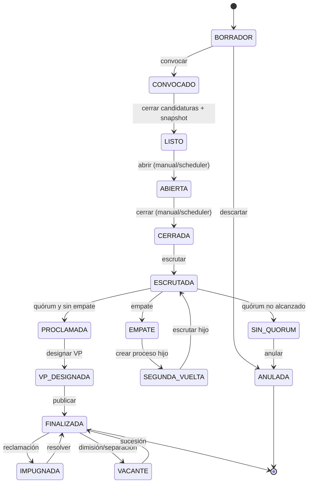
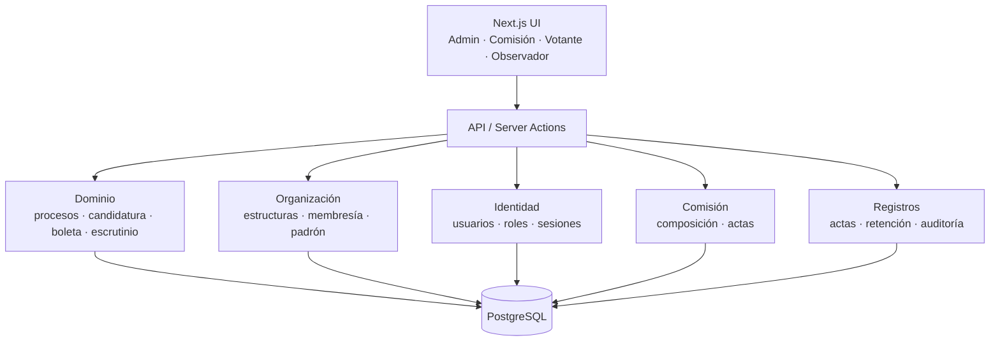

# 09 - Plan de implementación: Facultad de Ingeniería Informática

> **Documento vigente.** El análisis legal y las reglas generalizadas están en `08-marco-legal-feu.md`. El stack es el de la decisión de arquitectura: Next.js 15 + React 19 + PostgreSQL 17 + Prisma + Auth.js + Tailwind 4 + shadcn/ui.
>
> **v1:** elección del Secretariado de la Facultad de Ingeniería Informática. **Diseño:** multi-nivel, configurable y adaptable a otras facultades, sedes, filiales, centros y al nivel nacional.

---

## 1. Resumen ejecutivo

### 1.1 Qué construye v1

Un sistema web para que la membresía de la Facultad de Ingeniería Informática elija a su Secretariado:

- La Comisión Electoral carga **todos los candidatos**; el sistema deriva los puestos (`N = candidatos − 2`) y arma la boleta.
- Un asistente inicial configura la cantidad de candidatos, la ventana de votación (con cierre anticipado) y las reglas.
- Los datos se cargan por formulario o por importación CSV/XLSX desde una plantilla descargable; las brigadas se definen antes.
- Los candidatos se escogen de los datos importados o creados; cada uno puede tener biografía `.md` legible desde la boleta.
- Una sección **Reglamento** muestra el texto literal de los artículos aplicables con fuente y página.
- Cada miembro de la Facultad vota una sola vez, de forma **secreta**, marcando **hasta `N` miembros** y **exactamente 1 presidente** que debe estar entre los marcados.
- Si la boleta tiene errores, se avisa y el elector puede confirmarla como **anulada** en dos pasos.
- El sistema cuenta los votos, valida el **>85 % de quórum**, resuelve empates según el Art. 40 y proclama a los **`N` electos** y al presidente.
- Cerrada la votación, la Comisión **designa al vicepresidente entre los electos** (con recomendación) y publica los resultados finales.
- Registra la **dimisión o separación del presidente** y la vacante: asume el VP por defecto, con opción de elegir otro electo.
- Genera acta, conserva las boletas al menos un año y permite observación del conteo.
- El mismo modelo permite cambiar columnas, modo de votación, quórum y reglas de mayoría para otros niveles, sin reescribir el dominio. En v1 solo se implementa Facultad.

### 1.2 Cambios principales respecto del plan anterior

| Tema | Plan anterior (demo) | Plan vigente |
|---|---|---|
| Alcance | Universidad, 9 puestos, 11 candidatos. | Facultad; **11 candidatos → 9 puestos** en la demo; `N` se deriva de la lista. |
| Marcas de miembro | Exactamente 9. | Hasta `N` (1..N); `0` es inválida. |
| Boleta inválida | Se aceptaba o se descartaba. | Aviso inline y, si el elector insiste, **anulada en dos pasos**. |
| Voto en blanco | Se contemplaba. | **No existe**; abstenerse es no votar. |
| Presidente | Entre los 9 más votados. | Entre los `N` electos. |
| Empate | Votos de miembro y orden alfabético. | Votos de presidente y **nueva votación**; nunca orden alfabético. |
| Quórum | 85 % / 80 % general. | >85 %; 80 % solo universidad con consulta nacional. |
| Boleta | Columna Facultad. | Columna **Brigada** en Facultad. |
| Candidatura | Sin validación de brigada ni aprobación del Consejo. | Lista cargada directamente; sin requisitos bloqueantes. |
| Vicepresidente | Se elegía en la boleta. | Se designa **después del cierre**. |
| Vacante | No contemplada. | **Dimisión/separación** del presidente con sucesión. |
| Comisión | Rol genérico. | Entidad con composición, actas y funciones. |
| Retención | No definida. | ≥1 año, sellada, con acta. |
| Reclamaciones | Fuera de alcance. | Registro y plazos en v1; resolución completa en v1.1. |
| Niveles | Solo universidad. | Modelo multi-nivel; UI de Facultad en v1. |

### 1.3 Decisión de producto

No se implementa una «elección universitaria con 9 puestos»: se implementa una **elección de Facultad configurable** cuyo tamaño sale de la lista cargada. La escalabilidad no se logra copiando pantallas, sino separando:

- **Estructura** (dónde se elige).
- **Proceso** (qué se elige y con qué reglas).
- **Candidatos** (quiénes compiten).
- **Boleta** (cómo se vota).
- **Resultado** (cómo se cuenta y se proclama).
- **Composición** (presidente, vicepresidente y vacantes).

---

## 2. Alcance

### 2.1 Dentro de v1

1. **Configuración inicial del proceso**
   - Asistente que crea el proceso: estructura, año, **cantidad de candidatos**, ventana de votación (`abre_en`, `cierra_en`) y reglas.
   - La cantidad de candidatos es la entrada; los puestos se derivan con `N = candidatos − 2`.
   - La ventana se puede **cerrar antes** manualmente; nunca prorrogar.
   - Las reglas quedan congeladas al pasar de `BORRADOR` a `CONVOCADO`.
2. **Organización**
   - Facultad de Ingeniería Informática y sus brigadas.
   - **Las brigadas se crean antes de importar**: son la referencia válida para el padrón y los candidatos.
   - Jerarquía preparada para centro/universidad y otras facultades.
3. **Datos: formulario e importación**
   - Alta individual por formulario.
   - Importación **CSV o XLSX** desde una plantilla.
   - **Descarga de plantilla de ejemplo** con encabezados, tipos y una fila de muestra.
   - Validación previa: columnas exactas, CI única, brigada existente, campos obligatorios, duplicados.
   - Informe de errores por fila; nada se importa si el archivo no cumple la plantilla.
   - Importación idempotente y con hash del archivo.
4. **Padrón**
   - Importación de estudiantes habilitados con el mismo mecanismo.
   - Validación de CI/identificador, nombre, brigada y duplicados.
   - Activación de acceso y control de elegibilidad.
5. **Identidad y roles**
   - `ADMIN`, `COMMISSION`, `VOTER`, `OBSERVER`.
   - MFA para administración y comisión.
   - Sesiones, rate limiting y auditoría.
6. **Comisión Electoral**
   - Composición (presidente, vicepresidente, representantes).
   - Acta de constitución.
   - Funciones y decisiones registradas.
7. **Candidatos**
   - Se **escogen de las personas ya importadas o creadas**; no se teclean dos veces.
   - Datos personales, brigada y datos opcionales de referencia (validación por brigada, aprobación del Consejo).
   - **Biografía en Markdown (`.md`)**: carga, edición, vista previa, versión y hash.
   - La biografía se puede **leer desde la boleta** antes de votar.
   - Derivación automática de `N = candidatos − 2` y snapshot inmutable.
8. **Configuración del proceso**
   - Modo de votación, quórum, reglas de mayoría y desempate.
   - Fechas, estado y cierre anticipado.
9. **Boleta**
   - 4 columnas: Apellidos y Nombres, Brigada, Miembro, Presidente.
   - Hasta `N` marcas de miembro; 1 presidente entre los marcados.
   - Enlace «Leer biografía» por candidato, con el Markdown renderizado de forma segura.
   - Revisión, aviso de errores y anulación en dos pasos.
10. **Votación**
    - Un voto por miembro.
    - Secreto estructural.
    - Comprobante de alta entropía.
    - Idempotencia y concurrencia.
11. **Escrutinio**
    - Top `N`; presidente entre electos.
    - Quórum >85 %.
    - Empate: votos de presidente; si persiste, nueva votación.
    - Resultado inmutable y hasheado.
12. **Proclamación y acta**
    - Acta con firmantes, hash y sello temporal.
    - Retención de boletas y acta.
13. **Cierre post-electoral**
    - Designación del vicepresidente después del cierre, entre los electos.
    - Resultados finales con la composición completa.
    - Registro de dimisión/separación del presidente y sucesión.
14. **Reglamento**
    - Sección con el **texto literal** de los artículos que aplican a la Facultad.
    - Cada artículo indica **fuente**: documento, número de artículo y página.
    - Fuente versionada: `ABC-FEU-2019.pdf`, con hash y fecha de carga.
    - Búsqueda por artículo y por texto; enlace desde las reglas del proceso al artículo que las origina.
15. **Reportes**
    - Resultados, conteos por miembro y presidente, participación, anuladas, quórum.
    - CSV/PDF.
    - Vista de observador.
16. **Reclamaciones**
    - Registro, plazo de 5 días hábiles y seguimiento.
17. **Theming y accesibilidad**
    - Temas verde/amarillo con contraste AA.
    - Sin herencia visual del escritorio.

### 2.2 Fuera de v1

- **Espacios de propuesta (Q-L03):** la boleta de v1 no los muestra ni los captura. Queda como trabajo futuro documentado en §12.
- **Voto público ≤100 y Art. 58 (Q-L04/Q-L05):** v1 asume siempre >100 y voto secreto. El modo público queda como fase final en §12.
- Elecciones de **sede, filial, residencia, centro/universidad y nacional**: el modelo de datos las admite, pero **no hay código, endpoints ni UI** para ellas. El trabajo futuro se documenta en §12.
- Resolución completa de reclamaciones (se registra y se controla el plazo).
- Trámite formal de candidatura (validación por brigada y aprobación del Consejo) como flujo bloqueante; solo se registra como referencia.
- Promoción de vacantes por el Consejo más allá del registro y la sucesión básica.
- SSO institucional, app móvil, blockchain.
- Firma digital legal.

> La **segunda vuelta** por empate sí se implementa en v1 como proceso hijo (F5). Lo que queda fuera es la logística operativa de fijar una nueva fecha fuera de la jornada; hasta que se resuelva, el proceso permanece en `EMPATE` y no se proclama.

---

## 3. Configuración funcional de v1

| Parámetro | Valor | Tipo | Fuente |
|---|---|---|---|
| Estructura | Facultad de Ingeniería Informática | Fija en v1 | Cliente |
| Nivel | `FACULTAD` | Enum | Art. 36 |
| Órgano | `SECRETARIADO` | Enum | Arts. 10, 13 |
| Candidatos | Todos los que se carguen; demo **11** | Entrada | Art. 59 |
| Puestos (`N`) | **Derivado**: `candidatos − 2` (11 → **9**) | Derivado | Art. 59 |
| Brigadas | Se crean antes de importar | CRUD | Art. 3 |
| Plantilla de importación | CSV + XLSX con ejemplo y validación | Archivo | Decisión v1 |
| Espacios de propuesta | **Fuera de v1** (Q-L03); no se muestran ni capturan | Diferido | Art. 59 |
| Electorado | Membresía de la Facultad; demo **300** | Padrón | Art. 37 |
| Modo | **`SECRETO`**; v1 asume padrón >100 | Enum | Arts. 37, 58 |
| Quórum | **>85 %** | Decimal | Art. 38 |
| Excepción 80 % | Deshabilitada para Facultad | Decimal opcional | Art. 38 |
| Marcas de miembro | **1..N**; `0` es inválida | Rango | Art. 61 |
| Boleta inválida | Aviso inline; segundo intento = `ANULADA_POR_ELECTOR` | Flujo | Decisión v1 |
| Biografía | `.md`, sanitizado, versión con hash | Texto | Decisión v1 |
| Reglamento | Texto literal con fuente y página | Módulo | Arts. 36–108 |
| Marcas de presidente | **1**, entre los miembros marcados | Entero | Art. 61 |
| Electos | Top `N` por votos de miembro | Regla | Art. 63 |
| Presidente | Entre los `N` electos, el de más votos de presidente | Regla | Art. 63 |
| Umbral de mayoría | Ninguno en Facultad | Enum | Art. 63 |
| Empate | Miembro → votos de presidente; presidente → nueva votación | Regla | Art. 40 |
| Columnas | Apellidos y Nombres, Brigada, Miembro, Presidente | Lista | Art. 60 |
| Validación de candidato | Opcional; solo referencia | Requisito no bloqueante | Art. 39 |
| Aprobación de candidatura | Opcional; solo referencia | Requisito no bloqueante | Art. 42 |
| Comisión | Presidente, vicepresidente, representantes | Entidad | Art. 47 |
| Retención | ≥365 días | Entero | Art. 66 |
| VP | Designado después del cierre; sin plazo | Requisito | Art. 67 |
| Vacante presidencial | Registro y sucesión | Requisito | Arts. 99–102 |
| Reclamaciones | 5 días hábiles; 15 días hábiles | Plazos | Arts. 103–106 |

> **Regla de oro:** `N` no se configura por separado. Se deriva de la lista: `N = candidatos − 2`. La demo carga **11 candidatos → 9 puestos**. Mínimo 5 candidatos (`N ≥ 3`).

### 3.1 Estados del proceso

| Estado | Qué significa | Quién lo activa | Qué se puede hacer | Duración |
|---|---|---|---|---|
| `BORRADOR` | Proceso en preparación; nada público. | ADMIN / COMMISSION | Editar reglas, cargar padrón y candidatos, previsualizar boleta, borrar. | Sin límite hasta convocar. |
| `CONVOCADO` | Fechas y reglas publicadas; se reciben candidatos. | COMMISSION | Cargar/editar candidatos; importar padrón; comunicar. | Configurable (ej. 5 días). |
| `LISTO` | Candidatos completos, `N` derivado, snapshot y padrón congelados. | COMMISSION | Previsualizar boleta; verificar quórum; abrir. | Hasta `opens_at` (ej. 1 día). |
| `ABIERTA` | Votación activa. | COMMISSION o scheduler | Emitir voto; ver comprobante; observar participación. | `opens_at`–`closes_at` (ej. 08:00–20:00). |
| `CERRADA` | No se aceptan votos; pendiente escrutinio. | Scheduler o COMMISSION | Escrutar. | Minutos. |
| `ESCRUTADA` | Conteo hecho; quórum y empates evaluados. | COMMISSION | Proclamar si hay quórum y no hay empate. | Minutos. |
| `EMPATE` | Empate en el corte o en la presidencia. | Automático | Crear segunda vuelta. | Hasta nueva votación. |
| `SEGUNDA_VUELTA` | Proceso hijo con los empatados. | COMMISSION | Votar y escrutar la nueva vuelta. | Ventana propia. |
| `SIN_QUORUM` | No se alcanzó el >85 %. | Automático | Anular o crear un proceso nuevo. | Hasta decisión. |
| `PROCLAMADA` | `N` electos y presidente proclamados. | COMMISSION | Designar vicepresidente. | Mismo día o siguiente. |
| `VP_DESIGNADA` | Composición completa. | COMMISSION | Publicar resultados finales. | Minutos. |
| `FINALIZADA` | Resultados finales publicados e inmutables. | COMMISSION | Reclamar, registrar vacante. | Permanente. |
| `IMPUGNADA` | Reclamación en plazo. | VOTER / COMMISSION | Resolver. | 5 días para presentar; 15 para resolver. |
| `VACANTE` | Dimisión/separación del presidente. | COMMISSION | Registrar sucesión. | Hasta resolver. |
| `ANULADA` | Proceso sin efecto. | COMMISSION | Consultar histórico. | Permanente. |

### Roles y quién cambia cada estado

**ADMIN — inicio y estados decisivos:** es el único que inicia el proceso y cambia los estados decisivos de la elección.

- Crea el proceso en `BORRADOR`.
- Convoca: `BORRADOR → CONVOCADO`.
- Abre la votación: `LISTO → ABIERTA`.
- Cierra la votación: `ABIERTA → CERRADA` (solo puede adelantar el cierre, nunca prorrogarlo).

**COMMISSION — estados intermedios que el VOTER no ve:** gestiona los estados intermedios invisibles para el votante.

- Cierra candidaturas + snapshot: `CONVOCADO → LISTO`.
- Escrutinio: `CERRADA → ESCRUTADA`.
- Proclamación: `ESCRUTADA → PROCLAMADA`.
- Designación del vicepresidente: `PROCLAMADA → VP_DESIGNADA`.
- Resultado final y vacantes: `VP_DESIGNADA → FINALIZADA` y `FINALIZADA → VACANTE`.
- Segunda vuelta: `EMPATE → SEGUNDA_VUELTA`.

**VOTER — solo ve e interactúa en `ABIERTA`:** emite su voto único, consulta su comprobante y lee las biografías de los candidatos. No puede cambiar ningún estado.

El scheduler solo ejecuta la apertura y el cierre (`LISTO → ABIERTA` y `ABIERTA → CERRADA`) bajo la autorización del ADMIN y dentro de la ventana configurada; no actúa por iniciativa propia.



**Reglas de transición**

- Solo hay **un proceso activo** por estructura y año lectivo.
- `BORRADOR` es totalmente editable. `CONVOCADO` congela reglas, fechas y columnas. `LISTO` congela candidatos, orden de boleta y padrón. `ABIERTA` congela todo.
- El paso `LISTO → ABIERTA` y `ABIERTA → CERRADA` lo puede hacer el scheduler a la hora configurada o la Comisión manualmente. El cierre manual solo puede adelantar el cierre, nunca prorrogarlo.
- No se reabre un proceso: si hay que corregir algo, se anula y se crea uno nuevo.
- Cada transición escribe un evento de auditoría con actor, fecha, estado anterior, estado nuevo y hash.
- Solo se aceptan boletas en `ABIERTA` y antes de `closes_at`, validando la hora del servidor dentro de la misma transacción.
- Solo se escruta en `CERRADA`; solo se proclama en `ESCRUTADA` con quórum y sin empate.
- `FINALIZADA` es inmutable: las reclamaciones y vacantes generan versiones, no mutaciones.

### 3.2 Reglas de aceptación de la boleta

| Caso | Resultado |
|---|---|
| `N` marcas de miembro + 1 presidente entre ellas | Válida. |
| Menos de `N` marcas + 1 presidente entre ellas | Válida (Art. 61 permite «hasta»). |
| 0 marcas | Inválida; se puede emitir como **anulada** tras confirmación. |
| `N+1` marcas de miembro | Inválida; se puede emitir como **anulada**. |
| 1 presidente que no está marcado como miembro | Inválida; se puede emitir como **anulada**. |
| 0 presidentes con marcas de miembro | Inválida; se puede emitir como **anulada**. |
| 2 presidentes | Inválida; se puede emitir como **anulada**. |
| Marca duplicada | Inválida; se puede emitir como **anulada**. |
| Candidato fuera de la lista cargada | No aparece en la boleta. |
| Espacios de propuesta | No existen en v1; trabajo futuro (Q-L03). |

**Regla de conteo:** solo las boletas **válidas** suman votos. Las **anuladas** suman a la participación y al quórum, pero no a ningún candidato. Quien **no emite boleta** no suma a la participación.

**Flujo de anulación por el elector**

1. El votante marca y pulsa **Siguiente**.
2. Si hay errores, se muestran **inline y resaltados** (por ejemplo: «Marcaste 2 presidentes», «No marcaste ningún miembro»). No se emite nada.
3. El botón cambia a **Emitir como anulada**.
4. Si vuelve a pulsar, aparece una confirmación: «Tu boleta quedará anulada y no contará para ningún candidato».
5. Al confirmar, se registra `ANULADA_POR_ELECTOR` con los motivos y las selecciones crudas para auditoría.
6. La participación queda consumida: no puede volver a votar.

> **Abstención ≠ boleta anulada.** Abstenerse es no emitir boleta y no suma a la participación. Una boleta emitida, aunque sea anulada, **sí cuenta como participación**; solo las boletas válidas suman votos.

### 3.3 Modo de votación

**v1 asume que la Facultad siempre tiene más de 100 miembros habilitados.** Por eso el voto es **secreto** y no se implementa el modo público.

- La boleta no se vincula al votante; solo se registra que votó.
- «Membresía» es el número de estudiantes habilitados en el padrón.
- El modo público para ≤100 y el caso especial del Art. 58 (elección solo de presidente) quedan **diferidos a una fase final** (Q-L04 y Q-L05, B-05).
- Si en el futuro el padrón bajara de 100, no se cambia un interruptor: se habilita un flujo distinto, con otra boleta y otro escrutinio.

Para la demo: padrón ficticio de **300 miembros** → voto secreto, 11 candidatos → 9 puestos.

---

## 4. Arquitectura

### 4.1 Stack

Se mantiene el stack acordado:

- **Frontend/Backend:** TypeScript + Next.js 15 (App Router) + React 19.
- **Base de datos:** PostgreSQL 17.
- **ORM:** Prisma; SQL directo para bloqueos y agregaciones críticas.
- **Autenticación:** Auth.js + Argon2id + TOTP.
- **UI:** Tailwind CSS 4 + shadcn/ui/Radix.
- **Validación:** Zod.
- **Pruebas:** Vitest, fast-check, Testcontainers, Playwright, axe, k6.
- **Despliegue:** Docker, reverse proxy, PostgreSQL gestionado/on-premise.

No se cambia el stack por el nuevo alcance. El cambio es de **modelo y configuración**, no de tecnología.

### 4.2 Módulos



| Módulo | Responsabilidad |
|---|---|
| `organization` | Estructuras, jerarquía, brigadas, membresía. |
| `census` | Importación CSV/XLSX, validación, plantilla. |
| `identity` | Usuarios, roles, sesiones, MFA, activación. |
| `process` | Configuración inicial, estados, convocatoria, snapshot. |
| `candidates` | Candidatos, biografía `.md` y datos de referencia. |
| `ballot` | Boleta, selecciones, biografía legible y emisión. |
| `tally` | Escrutinio, quórum, empates, segunda vuelta. |
| `commission` | Comisión, actas, funciones. |
| `post_election` | Designación del vicepresidente, composición final y vacantes. |
| `records` | Acta, resultados, retención, exportaciones. |
| `claims` | Reclamaciones y plazos. |
| `regulation` | Módulo «Reglamento»: texto literal, fuentes y búsqueda. |
| `audit` | Eventos append-only, hashes, trazabilidad. |
| `theming` | Tokens, temas, accesibilidad. |

### 4.3 Modelo de datos mínimo

| Tabla | Campos clave |
|---|---|
| `structures` | `id`, `type`, `name`, `parent_id`, `level`, `membership_count`. |
| `memberships` | `id`, `structure_id`, `student_id`, `full_name`, `brigade_id`, `eligible`, `user_id`. |
| `users` | `id`, `email`, `name`, `password_hash`, `role`, `active`, `mfa_secret`. |
| `electoral_processes` | `id`, `structure_id`, `type`, `academic_year`, `status`, `candidates_count`, `seats` (derivado), `proposal_slots`, `voting_mode`, `quorum_pct`, `quorum_exception_pct`, `majority_rule`, `tie_rule`, `columns`, `opens_at`, `closes_at`, `snapshot_hash`. |
| `candidacies` | `id`, `process_id`, `status`, `total_candidates`, `hash`. |
| `candidates` | `id`, `first_surname`, `second_surname`, `name`, `ci`, `faculty_id`, `brigade_id`, `year`, `gender`, `biography_md`, `biography_hash`, `biography_updated_at`, `brigade_validated` (opcional), `validation_evidence` (opcional). |
| `process_candidates` | `id`, `process_id`, `candidate_id`, `ballot_position`, `status`, `member_votes`, `president_votes`, `elected`, `office`. |
| `ballots` | `id`, `process_id`, `receipt_hash`, `state` (`VALIDA`/`ANULADA_POR_ELECTOR`), `motivos`, `cast_at`, `sequence`, `integrity_hash`. |
| `ballot_selections` | `ballot_id`, `process_candidate_id`, `member`, `president`. |
| `ballot_proposals` | Reservado; no se usa en v1 (Q-L03). |
| `participations` | `process_id`, `membership_id`, `cast_at`, `method`; unique. |
| `results` | `id`, `process_id`, `valid_ballots`, `annulled_ballots`, `participation`, `quorum_pct`, `quorum_met`, `hash`, `status`, `proclaimed_at`, `composition`. |
| `result_candidates` | `result_id`, `process_candidate_id`, `member_votes`, `president_votes`, `elected`, `rank`, `office`. |
| `vice_president_designations` | `id`, `process_id`, `elected_id`, `designated_by`, `acta`, `designated_at`, `status`. |
| `vacancy_events` | `id`, `process_id`, `office`, `type`, `reason`, `acta`, `occurred_at`, `successor_id`, `status`. |
| `commissions` | `id`, `process_id`, `president_id`, `vice_president_id`, `members`, `constituted_at`, `acta`. |
| `acts` | `id`, `process_id`, `type`, `content`, `hash`, `signed_at`, `signers`. |
| `claims` | `id`, `process_id`, `filed_by`, `reason`, `status`, `deadline`, `resolution`. |
| `brigades` | `id`, `structure_id`, `code`, `name`, `active`. |
| `import_batches` | `id`, `process_id`, `kind` (`MEMBERSHIPS`/`CANDIDATES`), `file_hash`, `template_version`, `status`, `rows_ok`, `rows_error`, `created_at`. |
| `import_errors` | `batch_id`, `row_number`, `field`, `message`. |
| `regulation_articles` | `id`, `document`, `article`, `page`, `literal_text`, `source_hash`, `active`. |
| `audit_events` | `id`, `process_id`, `actor_id`, `action`, `entity`, `payload_hash`, `occurred_at`, `sequence`. |

**Restricciones críticas:**

- `UNIQUE(process_id, membership_id)` en participación.
- `UNIQUE(process_id, receipt_hash)` en boleta.
- `CHECK (president => member)` en selección.
- `UNIQUE(ballot_id, process_candidate_id)`.
- `UNIQUE(process_id, ballot_position)` en candidato del proceso.
- `ballots` **no** tiene `membership_id` ni `voter_id`.

### 4.4 API propuesta

| Método | Ruta | Uso |
|---|---|---|
| `POST` | `/api/auth/login` | Acceso. |
| `POST` | `/api/auth/logout` | Cierre. |
| `GET` | `/api/processes/:id` | Configuración y estado. |
| `POST` | `/api/processes/:id/open` | Abrir (Comisión). |
| `POST` | `/api/processes/:id/close` | Cerrar. |
| `POST` | `/api/processes/:id/tally` | Escrutinio idempotente. |
| `POST` | `/api/processes/:id/proclaim` | Proclamar. |
| `POST` | `/api/processes/:id/vice-president` | Designar vicepresidente tras el cierre. |
| `POST` | `/api/processes/:id/vacancies` | Registrar dimisión/separación y sucesión. |
| `GET` | `/api/processes/:id/ballot` | Boleta del votante. |
| `POST` | `/api/processes/:id/vote` | Emitir voto. |
| `GET` | `/api/processes/:id/receipt/:code` | Verificar comprobante. |
| `GET` | `/api/processes/:id/results` | Resultados. |
| `GET` | `/api/processes/:id/act` | Acta. |
| `POST` | `/api/processes/:id/claims` | Reclamación. |
| `GET` | `/api/processes/:id/audit` | Auditoría. |
| `GET` | `/api/brigades` | Listar brigadas de la estructura. |
| `POST` | `/api/brigades` | Crear brigada (antes de importar). |
| `GET` | `/api/import/template/:kind` | Descargar plantilla CSV/XLSX de ejemplo. |
| `POST` | `/api/import/:kind` | Importar CSV/XLSX con validación previa. |
| `GET` | `/api/import/:batchId/errors` | Errores por fila. |
| `POST` | `/api/candidates/:id/biography` | Guardar biografía `.md` (con hash y versión). |
| `GET` | `/api/candidates/:id/biography` | Leer biografía renderizada. |
| `GET` | `/api/regulation` | Listar artículos. |
| `GET` | `/api/regulation/:article` | Texto literal de un artículo. |

> Las rutas de administración y comisión exigen autorización en servidor, no solo ocultamiento en la UI.

### 4.5 Configuración, no constantes

El dominio recibe un objeto `ProcessRules`:

```ts
type ProcessRules = {
  level: "BRIGADA" | "FACULTAD" | "CENTRO" | "NACIONAL";
  seatsRule: "CANDIDATES_MINUS_TWO";
  extraCandidates: 2;
  proposalSlots: 0;         // reservado; v1 no los muestra (Q-L03)
  votingMode: "SECRET" | "PUBLIC";
  minMemberMarks: 1;        // no hay voto en blanco
  maxMemberMarks: number;   // derivado: seats
  presidentMarks: 1;
  quorumPct: number;
  quorumExceptionPct?: number;
  quorumExceptionScope?: "UNIVERSIDAD";
  majorityRule: "TOP_N" | "TOP_N_OVER_50" | "FIFTY_PLUS_ONE";
  tieRule: "PRESIDENT_VOTES_THEN_RUNOFF";
  columns: Array<"NAME" | "BRIGADE" | "FACULTY" | "PROVINCE">;
  vicePresident: "POST_TALLY_FROM_ELECTED" | "POST_TALLY_ANY";
  vacancy: "VP_SUCCEEDS" | "NEXT_ELECTED" | "NEW_ELECTION";
};
```

Ninguna pantalla ni servicio debe contener `9`, `11`, `85` ni `5` hardcodeados. `seats` se calcula en el dominio a partir de `candidates.length`. Si cambia la lista, cambia `N`; no hay un parámetro `seats` editable.

---

## 5. Algoritmos clave

### 5.1 Validación de la boleta

```text
N = candidatos_cargados - 2
si marcas_presidente != 1 -> inválida
si marcas_miembro == 0 -> inválida
si marcas_miembro > N -> inválida
si el presidente no está entre los miembros -> inválida
si hay candidato repetido -> inválida
si el candidato no pertenece a la lista cargada -> inválida
si no hay errores -> válida
```

Si hay errores, la UI los muestra y **no emite**. Un segundo intento confirmado se registra como `ANULADA_POR_ELECTOR`: cuenta participación, no suma votos y consume el voto.

La UI debe impedir la mayoría de estos casos; la validación del servidor es la autoridad.

### 5.2 Escrutinio

```text
N = candidatos_cargados - 2

para cada boleta válida:
  para cada selección de miembro: sumar 1 a candidato.miembro
  para la selección de presidente: sumar 1 a candidato.presidente

ordenar candidatos por:
  1. votos_miembro descendente
  2. votos_presidente descendente
  3. desempate determinista solo para presentación (no para decidir el corte)

electos = primeros N
si hay empate en el corte N/N+1:
  comparar votos_presidente de los empatados
  si persiste: estado EMPATE -> segunda vuelta entre los empatados
presidente = entre los electos, el de más votos_presidente
si hay empate de presidente:
  estado EMPATE -> segunda vuelta entre los empatados
```

**Prohibido:** desempatar por orden alfabético, por posición de lista o por `id`. El orden alfabético solo define la boleta, no el resultado.

### 5.3 Quórum

```text
participaciones = boletas_válidas + boletas_anuladas
participacion = participaciones / membresia_habilitada * 100
quorum_cumplido = participacion > 85
si nivel == UNIVERSIDAD y no se cumple:
  evaluar 80 % excepcional con aprobación del Secretariado Nacional
si nivel == FACULTAD:
  no aplicar 80 %
```

**Quién cuenta como votante:** todo el que emitió una boleta, sea válida o anulada. Solo **no cuenta** quien no emitió ninguna boleta (abstención).

**Qué cuenta como voto:** solo las boletas **válidas**. Las anuladas suman a la participación y al quórum, pero no suman votos a ningún candidato. La participación se calcula sobre la membresía habilitada, no sobre los usuarios registrados.

### 5.4 Segunda vuelta

- Se crea un **proceso hijo** con los candidatos empatados.
- Hereda estructura, padrón y reglas, pero solo los candidatos empatados.
- Se identifica como `RUNOFF` y se enlaza al proceso padre.
- El resultado del hijo actualiza la proclamación del padre; no se muta el resultado original.
- Si el empate persiste, se repite hasta decidir; el sistema no inventa un ganador.

### 5.5 Cierre post-electoral: vicepresidente y vacantes

**Designación del vicepresidente (Q-L13 = sí)**

1. Se cierra la votación y se escruta.
2. Se identifican los `N` electos y el presidente.
3. La Comisión designa al vicepresidente **entre los `N` electos**. El sistema **recomienda** al electo con más votos de miembro que no sea presidente, pero la Comisión puede elegir a cualquier otro electo.
4. La UI muestra el recomendado preseleccionado y la lista completa de electos; el cambio exige motivo y acta.
5. Se registra la designación y la fecha; **no hay plazo de 3 días**.
6. Los resultados finales muestran presidente, vicepresidente y `N−2` miembros.

**Vacante del presidente (Q-L14)**

- Tipos: `RENUNCIA`, `SEPARACION`, `INCAPACIDAD`, `FALLECIMIENTO`.
- Se registra el hecho, el acta y la fecha; el resultado original **no se altera**.
- **Sucesión recomendada:** asume el vicepresidente. La Comisión puede elegir a **otro de los electos**; la UI preselecciona al VP y permite el cambio con motivo y acta.
- **Al ascender el vicepresidente**, el puesto de VP se completa con el **siguiente electo con más votos**, también como recomendación; se puede elegir a otro electo de más abajo.
- Si no hay ningún electo disponible, el Consejo promueve (Arts. 101–102) o se convoca un nuevo proceso.
- Cada cambio genera una **nueva versión de composición**; el histórico se conserva y el resultado original permanece inmutable.

### 5.6 Invariantes y pruebas de propiedades

| ID | Propiedad |
|---|---|
| INV-01 | `1 ≤ marcas_miembro ≤ N` en toda boleta válida. |
| INV-02 | Exactamente 1 presidente por boleta válida. |
| INV-03 | Presidente ∈ miembros marcados. |
| INV-04 | `Σ votos_presidente = boletas_válidas`. |
| INV-05 | `Σ votos_miembro = Σ marcas` y `≤ N × boletas_válidas`. |
| INV-06 | Un miembro, una participación. |
| INV-07 | La boleta no contiene identidad del votante. |
| INV-08 | Dos escrutinios del mismo conjunto dan el mismo hash. |
| INV-09 | El orden de la boleta no cambia después de abrir. |
| INV-10 | Los votos se asignan por `process_candidate_id`, no por índice. |
| INV-11 | Sin quórum, sin válidas o con empate no se proclama. |
| INV-12 | El acta y el resultado son inmutables. |
| INV-13 | `N = candidatos − 2` y `N ≥ 3`; la boleta muestra exactamente `N+2` filas. |
| INV-14 | El VP se designa después del cierre, siempre entre los electos; la recomendación es el siguiente más votado y el cambio exige motivo registrado. |
| INV-15 | Toda vacante genera una nueva versión de composición sin mutar el resultado original; la sucesión recomendada es el VP y puede sustituirse por otro electo. |
| INV-16 | `participación = válidas + anuladas`; las anuladas no suman votos. |
| INV-17 | La biografía `.md` se sanitiza al guardar y al renderizar; no ejecuta HTML ni scripts. |
| INV-18 | El módulo Reglamento muestra el texto literal del artículo con su fuente y página. |

---

## 6. Fases de implementación

### F0 · Cierre de decisiones

| Aspecto | Detalle |
|---|---|
| **Objetivo** | Convertir las preguntas abiertas en decisiones firmadas. |
| **Duración** | 2 pw. |
| **Dependencias** | Ninguna. |
| **Entregable** | Acta de decisión de Q-L02 y del flujo post-electoral (VP y sucesión); matriz RGF → prueba. |
| **Estado** | **Cerrada técnicamente** en `10-acta-f0-y-matriz-trazabilidad.md` (pendiente solo la firma). |

**Actividades**

- Cerrar el flujo de boleta inválida: sin voto en blanco y anulación en dos pasos.
- Registrar el flujo post-electoral ya decidido: VP entre los electos y sucesión con recomendación.
- Acordar formato de acta, retención y observadores.
- Validar el catálogo RGF con la Comisión y, si aplica, con el Consejo.
- Congelar el alcance de v1: espacios de propuesta, voto público y otros niveles quedan fuera.

**Salida:** decisiones firmadas; ninguna pregunta bloqueante sin valor por defecto.

---

### F1 · Plataforma y modelo de organización

| Aspecto | Detalle |
|---|---|
| **Objetivo** | Tener una base desplegable y el modelo estructura/proceso. |
| **Duración** | 3 pw. |
| **Dependencias** | F0. |
| **Entregable** | Staging con migraciones, auditoría y seed de la Facultad. |

**Actividades**

- Scaffold Next.js, TypeScript estricto, Tailwind, Prisma, PostgreSQL.
- `structures`, `memberships`, `electoral_processes` y configuración inicial.
- Jerarquía: Centro → Facultad → Brigadas.
- **Brigadas antes que la importación**: CRUD de brigadas con código y nombre; son la referencia válida.
- Auditoría append-only y eventos base.
- Contenedor, CI, health checks, migraciones.
- Seed de la Facultad con 11 candidatos (9 puestos) y 2 brigadas de prueba.
- **Seed del módulo Reglamento** con los artículos aplicables y sus fuentes.

**Salida:** la Facultad existe en base, con configuración y brigadas; el proceso se crea en `BORRADOR`.

---

### F2 · Identidad, padrón, roles y Comisión

| Aspecto | Detalle |
|---|---|
| **Objetivo** | Autenticar a la membresía y separar funciones. |
| **Duración** | 4 pw. |
| **Dependencias** | F1. |
| **Entregable** | Login, importación de padrón, roles y Comisión. |

**Actividades**

- Usuarios, Argon2id, sesiones, MFA para ADMIN/COMMISSION.
- Roles `ADMIN`, `COMMISSION`, `VOTER`, `OBSERVER`.
- Importación CSV/XLSX de padrón: CI, nombre, brigada, facultad; **validación previa contra plantilla**; duplicados.
- **Descarga de plantilla de ejemplo** con encabezados, tipos y fila de muestra.
- Informe de errores por fila; importación atómica.
- Activación de cuenta y elegibilidad.
- Comisión Electoral: presidente, vicepresidente, representantes; acta de constitución.
- Rate limiting, bloqueo progresivo, auditoría de acceso.
- Pruebas de autorización por rol y por recurso.

**Salida:** un miembro del padrón puede activar su cuenta y acceder; un usuario sin rol no puede administrar; la Comisión está constituida.

---

### F3 · Candidatos y configuración del proceso

| Aspecto | Detalle |
|---|---|
| **Objetivo** | Cargar todos los candidatos y derivar los puestos. |
| **Duración** | 3 pw. |
| **Dependencias** | F1, F2. |
| **Entregable** | Lista cargada, `N` derivado, snapshot y proceso listo para abrir. |

**Actividades**

- **Asistente de configuración inicial** del proceso: cantidad de candidatos, ventana (`abre_en`, `cierra_en`), cierre anticipado permitido, reglas.
- Candidatos se **escogen de los datos ya importados o creados**; no se duplica información.
- Importación CSV/XLSX de candidatos con plantilla y validación previa.
- Biografía `.md` por candidato: carga, edición, vista previa, versión y hash.
- Campos opcionales de referencia: validación por brigada y aprobación del Consejo (no bloquean).
- Cálculo automático de `N = candidatos − 2`; mínimo **5 candidatos** (`N ≥ 3`).
- Orden alfabético por primer apellido, con desempate determinista.
- Snapshot inmutable y hash.
- Configuración de columnas, modo, quórum y reglas.
- Bloqueo de gestión después de abrir.

**Salida:** con 11 candidatos se calculan 9 puestos y la boleta tiene 11 filas; con 5 candidatos, 3 puestos; con 4 o menos, no se abre.

---

### F4 · Boleta y emisión

| Aspecto | Detalle |
|---|---|
| **Objetivo** | Emitir un voto válido, secreto y único. |
| **Duración** | 5 pw. |
| **Dependencias** | F3. |
| **Entregable** | Boleta funcional, comprobante y control de doble voto. |

**Actividades**

- Boleta con 4 columnas y `N+2` filas.
- Hasta `N` marcas de miembro; 1 presidente entre los marcados.
- Enlace «Leer biografía» por candidato, con el Markdown renderizado de forma segura.
- Validación inline y flujo de **anulación en dos pasos** (`ANULADA_POR_ELECTOR`).
- Revisión y confirmación; validación en servidor.
- Transacción: boleta + selecciones + participación.
- Comprobante de alta entropía; hash; verificación autenticada.
- Idempotencia y bloqueo de doble voto en concurrencia.
- Accesibilidad: teclado, lector, foco, contraste.

**Salida:** `N`+1 válida; `N−2`+1 válida; `N+1` inválida; presidente no miembro inválido; 0 marcas y 2 presidentes ofrecen anulación; anulada consumida; doble voto bloqueado; comprobante verificable.

---

### F5 · Escrutinio, empates, vicepresidente y proclamación

| Aspecto | Detalle |
|---|---|
| **Objetivo** | Contar de forma reproducible, proclamar con quórum y cerrar la composición. |
| **Duración** | 6 pw. |
| **Dependencias** | F4. |
| **Entregable** | Motor de escrutinio, quórum, segunda vuelta, designación del VP, vacantes y acta. |

**Actividades**

- Servicio de escrutinio puro, idempotente y transaccional.
- Top `N`; presidente entre electos; sin umbral en Facultad.
- Detección de empate en el corte y de presidente.
- Proceso hijo de segunda vuelta.
- Quórum >85 % sobre membresía habilitada; sin 80 % en Facultad.
- Resultado inmutable, hash y versión.
- Designación del vicepresidente después del cierre, con acta.
- Registro de vacantes (dimisión/separación) y sucesión.
- Acta con firmantes, sello temporal y composición final.
- Pruebas de propiedades y verificador independiente.

**Salida:** dos conteos dan el mismo hash; empate bloquea y habilita segunda vuelta; 84 % no proclama; 86 % sí; VP designado; dimisión registrada con sucesor; acta generada.

---

### F6 · Reportes, reclamaciones, auditoría y theming

| Aspecto | Detalle |
|---|---|
| **Objetivo** | Dar transparencia, evidencia y cumplimiento visual. |
| **Duración** | 4 pw. |
| **Dependencias** | F5. |
| **Entregable** | Reportes, acta PDF, registro de reclamaciones, temas y accesibilidad. |

**Actividades**

- Resultados finales: 1 presidente + 1 vicepresidente + (`N`−2) miembros + 2 no electos.
- Conteos por miembro y presidente.
- Participación, válidas, anuladas, quórum.
- Exportación CSV/PDF.
- Vista de observador y conteo observable.
- Registro de reclamaciones con plazo de 5 días hábiles.
- Auditoría visible para la Comisión.
- Historial de composición y vacantes.
- Temas verde/amarillo con tokens OKLCH y contraste AA.
- Textos `es-CU`, fechas America/Havana.

**Salida:** reportes cuadran con el resultado; acta PDF con composición; reclamación registrada con plazo; axe sin críticos; contraste AA.

---

### F7 · Endurecimiento, carga y continuidad

| Aspecto | Detalle |
|---|---|
| **Objetivo** | Soportar la jornada y recuperarse de fallos. |
| **Duración** | 3 pw. |
| **Dependencias** | F5, F6. |
| **Entregable** | Informe de seguridad, carga, respaldo y runbook. |

**Actividades**

- Pentest de autenticación, autorización, IDOR, CSRF, rate limit y secreto.
- Carga: 2 000 votantes y 300 concurrentes para v1; diseño para 10 000.
- p95 de boleta < 1 s; emisión < 800 ms; escrutinio < 30 s.
- Respaldo PITR, restauración ≤30 min, RPO ≤5 min.
- Retención/WORM de boletas y actas; control de acceso.
- Simulación de caída y modo de solo lectura.
- Alertas y dashboard.

**Salida:** sin vulnerabilidades altas/críticas; SLO cumplidos; restauración probada; runbook probado.

---

### F8 · Piloto y corte

| Aspecto | Detalle |
|---|---|
| **Objetivo** | Pasar a producción con evidencia y contingencia. |
| **Duración** | 2 pw. |
| **Dependencias** | F7. |
| **Entregable** | UAT, simulacro, capacitación y acta de go/no-go. |

**Actividades**

- UAT con la Comisión y el Consejo.
- Simulacro con 50–100 votantes y datos ficticios.
- Carga del padrón real y verificación de elegibilidad.
- Capacitación a Comisión, soporte y observadores.
- Ensayo de contingencia y restauración.
- Corte, smoke tests y monitoreo.
- Jornada electoral y post-elección: acta, exportación, respaldo.

**Salida:** simulacro sin pérdida de votos ni discrepancias; acta de aceptación firmada; runbook probado.

---

## 7. Cronograma y esfuerzo

### 7.1 Supuestos

- 2 desarrolladores full-stack.
- 0,5 QA (automatización y accesibilidad).
- 0,25 diseño de interacción.
- 0,2 DevOps/SRE.
- Comisión disponible para 3–4 validaciones.

### 7.2 Esfuerzo

| Fase | Esfuerzo (pw) | Acumulado | Semanas |
|---|---:|---:|---:|
| F0 | 2 | 2 | 1–2 |
| F1 | 3 | 5 | 3–5 |
| F2 | 4 | 9 | 6–8 |
| F3 | 3 | 12 | 9–10 |
| F4 | 5 | 17 | 11–13 |
| F5 | 6 | 23 | 14–16 |
| F6 | 4 | 27 | 17–18 |
| F7 | 3 | 30 | 19–20 |
| F8 | 2 | 32 | 21–22 |
| **Total** | **32** | | **20–24 con margen** |

> Rango de planificación: **30–34 pw**, **20–24 semanas** con el equipo indicado. Si la fecha electoral es inamovible, se recorta alcance (por ejemplo, reclamaciones o modo público), no la calidad del escrutinio.

### 7.3 Hitos

| Hito | Semana | Evidencia |
|---|---|---|
| M0 Decisiones abiertas | 2 | Acta Q-L. |
| M1 Plataforma y Facultad | 5 | Staging con estructura y proceso. |
| M2 Padrón y Comisión | 8 | Importación y login. |
| M3 Candidatos y `N` | 10 | Lista cargada; 11 candidatos → 9 puestos. |
| M4 Boleta | 13 | Voto válido, anulación en dos pasos y doble voto. |
| M5 Escrutinio, VP y vacantes | 16 | Quórum, top 5, segunda vuelta, sucesión. |
| M6 Release candidate | 20 | Reportes, acta, seguridad, carga. |
| M7 Producción | 22 | Simulacro y go/no-go. |

---

## 8. Pruebas y aceptación

### 8.1 Escenarios dorados de la Facultad

| ID | Escenario | Resultado |
|---|---|---|
| EF-01 | Cargar 11 candidatos. | `N=9`; boleta de 11 filas. |
| EF-02 | Cargar 5 candidatos. | `N=3`; boleta de 5 filas. |
| EF-03 | Cargar 4 candidatos. | No se abre (`N<3`). |
| EF-04 | Candidato sin validación de brigada o sin acta del Consejo. | Se permite; solo se muestra como referencia. |
| EF-05 | Boleta 9 miembros + 1 presidente miembro. | Válida. |
| EF-06 | Boleta 7 miembros + 1 presidente miembro. | Válida. |
| EF-07 | Boleta 10 miembros. | Inválida. |
| EF-08 | Presidente no miembro. | Inválida. |
| EF-09 | Dos presidentes. | Inválida; segundo intento = anulada. |
| EF-10 | Doble voto concurrente. | Una sola boleta. |
| EF-11 | 84 % de participación. | No se proclama. |
| EF-12 | 86 % de participación. | Se proclama. |
| EF-13 | Top 9 y presidente entre ellos. | 1 presidente + 8 miembros. |
| EF-14 | Empate en el corte 9/10. | Comparar presidente; si persiste, segunda vuelta. |
| EF-15 | Empate de presidente. | Segunda vuelta entre empatados. |
| EF-16 | Orden de boleta por primer apellido. | Orden correcto con acentos. |
| EF-17 | Boleta con 0 marcas. | Aviso inline; segundo intento = `ANULADA_POR_ELECTOR`; cuenta participación, no suma. |
| EF-18 | Anulada por el elector. | Consume el voto; no puede volver a votar. |
| EF-19 | Designación del vicepresidente tras el cierre. | El recomendado aparece preseleccionado; se puede elegir otro electo; composición final con VP. |
| EF-20 | Dimisión del presidente. | Asume el VP por defecto; se puede elegir otro electo; resultado original intacto. |
| EF-21 | Ascenso del VP a presidente. | Se recomienda el siguiente más votado para VP; se puede elegir otro electo. |
| EF-22 | Descarga de plantilla e importación CSV/XLSX válida. | Se importan todos los registros; brigadas deben existir. |
| EF-23 | Importación con brigada inexistente o CI duplicada. | Se rechaza el archivo; informe de errores por fila. |
| EF-24 | Biografía `.md` del candidato. | Se renderiza en la boleta de forma segura; versiones con hash. |
| EF-25 | Módulo Reglamento. | Muestra el texto literal del artículo con fuente y página. |

### 8.2 Pruebas de propiedades

- `INV-01`–`INV-12` con fast-check.
- Verificador independiente que recalcule desde la base y compare hashes.
- Prueba de permutación del orden de candidatos.
- Prueba de concurrencia con 100 intentos del mismo votante.
- Prueba de idempotencia del escrutinio.
- Prueba de que `ballots` no contiene identidad del votante.

### 8.3 Trazabilidad legal

Cada regla `RGF` de `08` debe tener:

1. Una prueba automatizada o un control de UI.
2. Una referencia al artículo.
3. Una evidencia en el acta de UAT.

### 8.4 UAT

La Comisión y el Consejo ejecutan los 25 escenarios con datos ficticios. Se registra resultado, evidencia y firma. Un fallo en quórum, secreto, conteo, VP o sucesión bloquea el go/no-go.

---

## 9. Datos y migración

### 9.1 No hay datos productivos que migrar

El sistema anterior es en memoria. No se migran usuarios, votos, códigos ni resultados. Se reutilizan como fixtures:

| Dato | Uso v1 | Acción |
|---|---|---|
| 11 candidatos de `DatosTemporales` | Fixture de estrés y nombres. | Portar los 11 nombres al seed de la Facultad; conservar el XLS real como prueba de importación. |
| 5 votantes y 1 admin | Fixture de login. | Reemplazar por padrón ficticio de la Facultad. |
| 9 facultades | Catálogo futuro. | Cargar solo Ingeniería Informática en v1; el resto, inactivas. |
| `Proyecto FEU/` (Java/Swing) | Demo de escritorio legacy. | **Referencia histórica**, no a portar. Aporta fixtures y la lógica original que se corrige. |
| `Información.txt` | Extracto legal incompleto. | Sustituir por `ABC-FEU-2019.pdf` versionado. |
| Tests JUnit | Regresión. | Convertir a pruebas de reglas y propiedades. |

### 9.2 Padrón e importación

**Plantilla decidida a partir del padrón real** (`! Listado Informática 2026.xls`, hoja `Estudiantes1`):

Columnas del padrón (en este orden, con estos nombres):

| Columna | Tipo | Obligatoria | Nota |
|---|---|---|---|
| `Carnet de Identidad` | texto numérico | Sí | Identificador único |
| `Nombre` | texto | Sí | Nombre(s) |
| `1er. Apellido` | texto | Sí | Primer apellido |
| `2do. Apellido` | texto | Sí | Segundo apellido |
| `Brigada` | código | Sí | Debe existir en `brigades` |
| `Facultad` | texto | Sí | Fija `Ingeniería Informática` en v1 |
| `Email` | texto | No | Si falta, se emite código de activación |

Columnas de candidatos (mismas base +):

| Columna | Tipo | Obligatoria | Nota |
|---|---|---|---|
| `Año` | entero | Sí | Año académico |
| `Género` | texto | No | |
| `Biografía (.md)` | texto largo | No | Markdown; se guarda con hash y versión |

- **Brigadas primero:** se crean con código y nombre; la importación valida contra ellas.
- **Plantilla descargable:** CSV y XLSX con encabezados, tipos y una fila de ejemplo, generada desde la misma definición.
- Importación atómica: si una fila falla, se informa y no se importa el bloque.
- Los estudiantes sin email reciben un código de activación.
- La membresía habilitada es la base del quórum.
- No se usan datos reales en staging sin anonimizar.

### 9.3 Seed de desarrollo

- Facultad de Ingeniería Informática.
- Brigadas con **códigos numéricos reales**: `11`, `12`, `22`, `32`, `41` (los mismos del demo Swing y del XLS de referencia).
- 20–50 votantes ficticios; para pruebas de quórum, un padrón de 300.
- 11 candidatos: repartidos entre las brigadas, con apellidos variados para probar el orden. → 9 puestos.
- Comisión: presidente, vicepresidente, 1 representante por brigada.
- Consejo: 3 presidentes de brigada + secretariado saliente.
- Datos opcionales de referencia: validación de brigada y acta del Consejo (no bloquean).

> **Origen de los fixtures:** el demo Swing legacy (`Proyecto FEU/src/auxiliar/DatosTemporales.java`) aporta los 11 candidatos de ejemplo, los 5 votantes y el administrador. Es material de referencia, no código a portar: la lógica del escritorio se reemplaza por el dominio descrito en §5.

---

## 10. Despliegue y corte

### 10.1 Entornos

| Entorno | Uso | Datos |
|---|---|---|
| Local | Desarrollo. | Seed ficticio. |
| CI | Pruebas. | Efímeros. |
| Staging | UAT, carga, simulacro. | Ficticios/anonimizados. |
| Producción | Jornada electoral. | Padrón real. |

### 10.2 Pipeline


### 10.3 Día de la elección

| Momento | Acción |
|---|---|
| T-7 días | Congelar cambios; backup; verificar padrón. |
| T-1 día | Desplegar RC; smoke; cargar padrón; capacitar. |
| T-2 h | Health, métricas, hora, certificados. |
| Apertura | La Comisión abre; se registra auditoría. |
| Durante | Monitorear votos/minuto, errores, latencia. |
| Cierre | La Comisión cierra; escrutinio; quórum. |
| Proclamación | Acta; resultados; publicación. |
| T+1 | Backup final; exportaciones; retrospectiva. |

### 10.4 Rollback y contingencia

- Rollback de aplicación a la imagen anterior.
- Migraciones forward-only; restaurar PITR solo si hay corrupción.
- Modo de solo lectura si falla la escritura.
- Contingencia manual con boletas de papel y acta.
- Criterio de aborto: pérdida de votos, corrupción del conteo o brecha de secreto.

---

## 11. Riesgos

| ID | Riesgo | Prob. | Impacto | Mitigación |
|---|---|---|---|---|
| R-01 | **Interpretación legal errónea** (anulación, ≤100, propuestas diferidas). | Alta | Crítico | F0 con acta firmada; valores por defecto; revisión de la Comisión. |
| R-02 | **Conteo/empate/segunda vuelta incorrectos.** | Media | Crítico | Propiedades, verificador independiente, escenarios dorados. |
| R-03 | **Designación de VP o sucesión mal registrada.** | Media | Alto | Flujo post-electoral, acta, versión de composición, pruebas. |
| R-04 | **Padrón incompleto o duplicado.** | Media | Alto | Importación validada, conciliación, período de reclamación. |
| R-05 | **Ruptura del secreto** por comprobantes o logs. | Media | Crítico | Separación estructural, hash, sin listados, pentest. |
| R-06 | **Doble voto** por concurrencia. | Media | Alto | Restricción única, idempotencia, pruebas. |
| R-07 | **Alcance multi-nivel** consume el calendario. | Media | Alto | v1 solo Facultad; flags; backlog. |
| R-08 | **Cambio del supuesto >100** (aparición de un padrón ≤100). | Baja | Medio | Diferido; el flujo público es una fase final (B-05). |
| R-09 | **Fecha electoral inamovible.** | Media | Alto | Recortar alcance, no escrutinio; hitos. |
| R-10 | **Accesibilidad/tema amarillo.** | Media | Medio | Tokens AA, axe, prueba manual. |
| R-11 | **Retención y privacidad.** | Baja | Alto | WORM, cifrado, política de datos. |
| R-12 | **Falta de soporte el día D.** | Baja | Alto | Runbook, guardias, contingencia. |

### 11.1 Los tres riesgos principales

1. **R-01 · Interpretación legal.** La anulación de la boleta y el límite de ≤100 no están cerrados en el Reglamento. Un error cambia la boleta y el resultado. Mitigación: acta de F0, revisión de la Comisión y pruebas de trazabilidad legal.
2. **R-02 · Escrutinio, empate y segunda vuelta.** La ley prohíbe desempatar por orden; exige nueva votación. Un algoritmo incorrecto o un empate mal detectado invalida la proclamación. Mitigación: propiedades, verificador independiente, escenarios de empate y revisión del acta.
3. **R-03 · Composición post-electoral.** Una designación de VP o una sucesión mal registrada deja el Secretariado incompleto o altera el resultado. Mitigación: flujo post-electoral, acta, versiones de composición y pruebas de vacante.

---

## 12. Backlog posterior a v1

| ID | Elemento | Valor | Requisito |
|---|---|---|---|
| B-01 | Otras facultades/sedes/filiales. | Escalar el sistema. | Flags y configuración. |
| B-02 | Nivel universidad con umbral >50 %. | Completar el modelo. | Art. 76. |
| B-03 | Nivel nacional y Congreso. | Completar el modelo. | Arts. 80–98. |
| B-04 | Elecciones de brigada y residencia. | Base del sistema. | Arts. 49–53. |
| B-05 | **Voto público ≤100 y Art. 58** (fase final). | Cumplimiento Art. 37/58. | Q-L04 diferida; v1 asume >100. |
| B-06 | Resolución completa de reclamaciones. | Transparencia. | Arts. 103–108. |
| B-07 | Promoción de vacantes por el Consejo (flujo completo). | Ciclo de dirección. | Arts. 99–102. |
| B-08 | SSO institucional. | Usabilidad. | Integración. |
| B-09 | Firma digital del acta. | Valor probatorio. | Requisito legal. |
| B-10 | Publicación en tiempo real. | Transparencia. | Q-L12. |
| B-11 | Trámite formal de candidatura (brigada y Consejo). | Fidelidad al Reglamento. | Arts. 39, 42, 54–57. |
| B-12 | **Espacios de propuesta en la boleta** (Q-L03). | Fidelidad al Art. 59. | Diferido; sin UI en v1. |

---

## 13. Decisiones pendientes y diferidas

**Bloqueantes de v1:** ninguna. Las decisiones de producto están cerradas.

**Cerradas relevantes para el cierre post-electoral:**

| Pregunta | Decisión |
|---|---|
| Q-L13 VP entre electos | Sí, siempre entre los `N` electos; recomendado el siguiente más votado, con opción de elegir otro electo. |
| Q-L14 Sucesión del presidente | Asume el VP por defecto; se puede elegir otro electo; al ascender el VP se recomienda el siguiente más votado. |

**Diferidas a una fase final** (no bloquean la demo):

| Pregunta | Motivo | Decisión v1 |
|---|---|---|
| Q-L03 Espacios de propuesta | No se implementan en v1. | La boleta no los muestra; se documentan en B-12. |
| Q-L04 Membresía ≤100 y Art. 58 | Se asume un padrón siempre >100. | Voto siempre secreto; el modo público queda en B-05. |
| Q-L05 Facultad ≤100 | Depende de Q-L04. | No aplica mientras el padrón sea >100. |

**Operativas con valor por defecto:**

| Pregunta | Bloquea | Fecha límite | Valor por defecto |
|---|---|---|---|
| Q-L07 Reclamaciones | F6 | Inicio F6 | Registro y plazo; resolución v1.1. |
| Q-L08 Retención | F1, F7 | Fin F1 | 1 año mínimo. |
| Q-L09 Observadores | F2, F6 | Inicio F2 | Acreditados por la Comisión. |
| Q-L11 Segunda vuelta | F5 | Inicio F5 | Toda la membresía, entre empatados. |
| Q-L12 Publicación | F6 | Inicio F6 | Después de proclamar. |
| Q-L15 Plantilla de importación | F2 | Fin F1 | CSV + XLSX, con ejemplo y validación. |
| Q-L16 Biografía `.md` | F4 | Inicio F4 | Solo Markdown, sanitizado, tamaño limitado, versión con hash. |
| Q-L17 Módulo Reglamento | F1 | Fin F1 | Texto literal de los arts. aplicables con fuente y página. |

---

## 14. Checklist de entrega

- [ ] Acta de decisiones abiertas F0 firmada.
- [ ] Candidatos cargados y `N = candidatos − 2` derivado.
- [ ] Estructura, brigadas y membresía cargadas.
- [ ] Comisión constituida con acta.
- [ ] Lista de candidatos con datos de referencia opcionales.
- [ ] Boleta con 4 columnas, hasta `N` miembros y 1 presidente.
- [ ] Validación inline y anulación en dos pasos.
- [ ] Voto secreto, único y con comprobante.
- [ ] Escrutinio top `N`, quórum >85 %, empates y segunda vuelta.
- [ ] Vicepresidente designado y composición final publicada.
- [ ] Vacante y sucesión probadas.
- [ ] Acta, retención ≥1 año y auditoría.
- [ ] Reportes y exportaciones conciliados.
- [ ] Reclamaciones con plazo.
- [ ] Temas verde/amarillo con contraste AA.
- [ ] Pentest sin altos/críticos.
- [ ] Carga y restauración probadas.
- [ ] Simulacro y go/no-go.

---

## 15. Resumen del plan

- **v1:** Secretariado de la Facultad de Ingeniería Informática. Se cargan los candidatos y se deriva `N = candidatos − 2`; la demo usa **11 candidatos → 9 puestos**, con boleta de hasta 9 miembros + 1 presidente.
- **Configuración inicial:** asistente con cantidad de candidatos, ventana de votación (cierre anticipado permitido) y reglas.
- **Datos:** alta por formulario o importación CSV/XLSX desde una plantilla descargable; brigadas creadas antes de importar; validación previa.
- **Candidatos:** se escogen de los datos importados o creados; biografía `.md` legible desde la boleta.
- **Boleta:** sin voto en blanco; 0 marcas es inválida y puede confirmarse como anulada en dos pasos. Solo las válidas suman votos; las anuladas suman participación; quien no vota no suma.
- **Modo:** v1 asume siempre **>100 miembros**, por lo que el voto es **secreto**; el modo público y el Art. 58 quedan para una fase final.
- **Legal:** >85 % de quórum; sin 80 % en Facultad; sin requisitos bloqueantes de candidatura; empate por votos de presidente y nueva votación.
- **Post-elección:** el vicepresidente se designa tras el cierre **entre los electos** (recomendación + opción de otro electo); la dimisión del presidente se resuelve igual, con sucesión versionada.
- **Reglamento:** módulo con el texto literal de los artículos aplicables, fuente y página.
- **Arquitectura:** monolito modular Next.js + PostgreSQL, configuración por proceso, dominio aislado y escrutinio puro.
- **Datos:** estructura, membresía, proceso, candidatos, boleta, participación, resultado, composición, comisión, acta, reclamación, brigadas, importaciones y artículos.
- **Escalabilidad:** columnas, modo, quórum y mayoría son configuración; v1 solo Facultad, el resto por flags.
- **Esfuerzo:** 32 pw, 20–24 semanas con 2 dev + 0,5 QA + apoyo de diseño/DevOps.
- **Riesgos:** interpretación legal, escrutinio/empates y composición post-electoral.

---

**Análisis legal:** [`08-marco-legal-feu.md`](08-marco-legal-feu.md) · **Acta F0 y trazabilidad:** [`10-acta-f0-y-matriz-trazabilidad.md`](10-acta-f0-y-matriz-trazabilidad.md)
